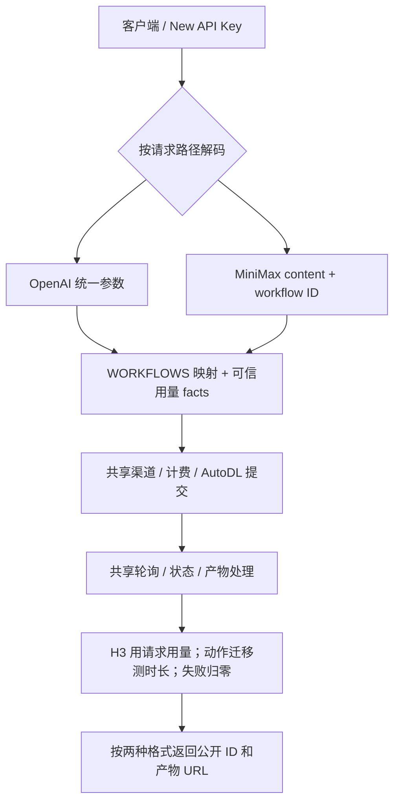

# AutoDL New API 插件 API 参考

版本 **1.0.19**。OpenAI Videos、OpenAI Speech 与 MiniMax 官方 V2 三套接口的参数、示例、响应与计费规则均在本文件；示例地址需替换为真实媒体。

## 5 分钟快速开始

两种接口是平等入口，按已有客户端和请求结构选择；没有默认推荐。`model` 一律填 AutoDL workflow ID，没有按模型名自动选择工作流的行为。提交都是异步任务，成功创建后需继续查询，不代表视频已生成。

| 接口 | 适用场景 | 模型与输入结构 |
|---|---|---|
| **OpenAI** `POST /v1/videos` | 已使用 OpenAI Videos 风格客户端；统一提示词、秒数、尺寸与参考媒体。 | 16 个视频 workflow ID（含动作迁移）；`prompt / seconds / size / input_reference / audios / videos`。 |
| **MiniMax** `POST /v2/video_generation` | MiniMax V2 客户端；需要 content 多媒体结构。 | 全部 17 个 AutoDL workflow ID；`content / resolution / duration / ratio`。 |

### 先准备

1. 管理员已安装并启用插件、完成渠道及模型价格/分组配置；本版本不需要任何服务器或反向代理改动。具体前提在本文件[基本配置](#基本配置)。
2. 以下命令使用 **Bash**（Linux/macOS/Windows Git Bash 或 WSL）；先替换 Base URL 和 **New API Key**。Base64 示例另需 Python 3。

```bash
export NEW_API_BASE_URL="https://api.example.com"  # 替换为你的 New API 根地址，不带末尾 /
export NEW_API_KEY="<NEW_API_KEY>"                # 替换为调用方 Key，不是 AutoDL Token
```

3. 媒体示例的 `https://media.example.com/...` 是占位地址，必须替换为公开可读的真实媒体；Base64 示例用自己的 PNG 文件。**只接受标准 Data URL，不支持裸 Base64；输出仍为公网 URL。**
4. 响应均为结构示意。将查询命令中的 TASK_ID 替换为本次创建返回的 ID，重复 GET 至成功/失败终态；不要重复 POST 同一任务。生成耗时与排队时间另计。

### OpenAI：文生视频

```bash
curl -sS -X POST "$NEW_API_BASE_URL/v1/videos" \
  -H "Authorization: Bearer $NEW_API_KEY" \
  -H 'Content-Type: application/json' \
  -d '{"model":"minimax_h3_lightx2v_no_pic","prompt":"一只猫在雪地中奔跑，镜头平稳跟随","seconds":1,"size":"864x480"}'
```

创建响应，任务 ID 取 **id**：

```json
{"id":"task_openai_xxx","object":"video","status":"queued","created_at":1785125529}
```

```bash
TASK_ID="task_openai_xxx"  # 替换为本次响应的 id
curl -sS "$NEW_API_BASE_URL/v1/videos/$TASK_ID" -H "Authorization: Bearer $NEW_API_KEY"
```

成功状态 **completed**，视频取 **url**，也可用带鉴权的 `/v1/videos/{task_id}/content` 下载；查询示意：

```json
{"id":"task_openai_xxx","object":"video","status":"completed","url":"https://media.example.com/result.mp4","results":[{"url":"https://media.example.com/result.mp4","type":"video"}]}
```

### MiniMax：图片 URL + 音频 URL

此例在 `model` 中直接填 AutoDL workflow ID，走同一 MiniMax V2 接口；插件没有按模型名自动选择工作流的机制。两个媒体 URL 均需替换为真实输入。

```bash
curl -sS -X POST "$NEW_API_BASE_URL/v2/video_generation" \
  -H "Authorization: Bearer $NEW_API_KEY" \
  -H 'Content-Type: application/json' \
  -d '{
    "model":"minimax_h3_image_audio_to_video_v2",
    "content":[
      {"type":"text","text":"人物面向镜头说话，保持参考人物外观"},
      {"type":"image_url","role":"reference_image","image_url":{"url":"https://media.example.com/person.png"}},
      {"type":"audio_url","role":"reference_audio","audio_url":{"url":"https://media.example.com/speech.wav"}}
    ],
    "resolution":"480P","duration":1,"ratio":"9:16"
  }'
```

创建响应，任务 ID 取 **task_id**：

```json
{"task_id":"task_minimax_xxx"}
```

```bash
TASK_ID="task_minimax_xxx"  # 替换为本次响应的 task_id
curl -sS "$NEW_API_BASE_URL/v2/query/video_generation/$TASK_ID" -H "Authorization: Bearer $NEW_API_KEY"
```

成功状态 **task.status = succeeded**，视频取 **task.content.url**：

```json
{"task":{"id":"task_minimax_xxx","status":"succeeded","task_type":"generation","modality":"video","content":{"url":"https://media.example.com/result.mp4"}}}
```

### OpenAI：图片 Base64 Data URL

将真实 PNG 保存为当前目录的 `person.png`（或修改路径）。命令先编码成 `data:image/png;base64,...`，再作为 `input_reference.image_url` 提交；MiniMax 格式同理，填进 `content[].image_url.url`：

```bash
IMAGE_DATA_URL="$(python3 -c 'import base64; from pathlib import Path; print("data:image/png;base64," + base64.b64encode(Path("person.png").read_bytes()).decode("ascii"))')"
curl -sS -X POST "$NEW_API_BASE_URL/v1/videos" \
  -H "Authorization: Bearer $NEW_API_KEY" \
  -H 'Content-Type: application/json' \
  -d "{\"model\":\"minimax_h3_lightx2v_v5\",\"prompt\":\"人物向镜头微笑，动作自然\",\"seconds\":1,\"size\":\"864x480\",\"input_reference\":{\"image_url\":\"$IMAGE_DATA_URL\"}}"
```

创建响应的任务 ID 取 **id**，查询与下载见下面的 [OpenAI Videos API](#openai-videos-api)。

以上成功视频 URL 可直接下载，**不要向媒体站点附带 New API/AutoDL Key**。图片、音频、视频输入都可替换为对应 MIME 的标准 Data URL；不增加协议没有的媒体字段（动作迁移没有音频输入）。

### 常用模型速查

下表都是直接填进 `model` 的 AutoDL workflow ID；`model` 没有自动路由。

| 场景 | 模型 / 工作流 | 最小输入与常用参数 |
|---|---|---|
| 文生视频 | `minimax_h3_lightx2v_no_pic` | 非空 prompt；1–15 秒；480p/768p；不传参考图。 |
| 单图生视频（也可多图） | `minimax_h3_lightx2v_v5` | prompt + 1–9 图；1–10 秒；480p/768p/1080p。 |
| 图+音频生视频 | `minimax_h3_image_audio_to_video_v2` | prompt，可带 0–9 图、0–3 音频；图+音频场景各传至少 1 个；1–10 秒。 |
| 首尾帧 | `minimax_h3_lightx2v` | prompt + 恰好 2 图；1–15 秒；480p/768p。 |
| 动作迁移 | `wan2.2animate-v4-motion_retargeting` | 1 图+1 视频；无 prompt/可控时长；计费秒数可选（结算以实测成片时长为准）；只有 OpenAI 格式可用渠道映射别名 `wan2.2-animate-move`。 |

OpenAI 用 prompt/seconds 等统一字段，MiniMax 用 content/duration 等。上表是工作流能力，不能把不同协议字段混写；全部 17 项默认值、媒体范围与分辨率在后面的[工作流参数表](#工作流目录与能力边界)。

### 快速错误排查

| 错误 | 先检查 / 处理 |
|---|---|
| `model_price_error` | 请求 model 未配置价格或计费规则无效；管理员补齐该 model 的价格。渠道映射的 `wan2.2-animate-move` 别名也需单独配置。 |
| `no_eligible_channel` | 渠道未启用、未包含请求 model，或 Key/用户组无可用渠道；检查 Task Plugin→AutoDL、模型列表及分组权限。 |
| `invalid media URL` | 输入不是有效 HTTP(S) URL/标准 Data URL，MIME 不匹配或 Base64 格式错误；不用裸 Base64，按对应字段类型编码。 |
| `intersects reserved namespace /api` | 安装了直接声明宿主保留路径的旧插件；更新为 **1.0.7** 即可，本版本只使用 `/v1/videos` 与 `/v2/...` 路径，不需要任何代理配置，也无需改宿主源码。 |
| `502 / 5xx` | 根据响应错误与宿主日志定位上游/宿主异常；暂时错误退避重试，若已取得 task ID，先查询该任务，避免重复付费提交。 |

以下保留完整字段、响应、工作流能力、计费和技术说明，可在本文件内继续查阅。


[配置](#基本配置) · [接口](#接口速查) · [输入媒体](#输入媒体url-与-data-url) · [OpenAI](#openai-videos-api) · [MiniMax](#minimax-官方-v2-api) · [工作流参数](#工作流目录与能力边界) · [动作迁移](#动作迁移与-wan22-animate-move-渠道别名) · [错误与计费](#错误轮询和计费)

## 基本配置

「任务插件 → 从 URL 导入」安装并启用 **AutoDL**（key `autodl`）：`https://raw.githubusercontent.com/yiyinfaith/new-api-plugin-autodl/main/plugin.js`。仅此文件即可运行，无仓库文件依赖；仓库首页不能作为源码 URL。

渠道选择 **Task Plugin（61）→ AutoDL**；Base URL `https://autodl.art`，不加 API 路径；密钥为 **AutoDL ComfyUI 分组 Token 原文，不加 Bearer**。加入要调用的模型，配置价格、分组权限并启用；安装不自动配置这些项。

使用官方 **New API v1.0.0-rc.43**，要求 Plugin API v1、usageProfiles、openai_video、credentialless 下载；**无需修改源码、重建镜像或安装 FFmpeg**。插件使用宿主自带的 `POST /v1/videos`（及其查询、内容下载路径）和插件自己注册的 `POST /v2/video_generation`、`GET /v2/query/video_generation/{task_id}`、`POST /autodl/v1/audio/speech`、`GET /autodl/v1/audio/speech/{task_id}`：这些路径都不与宿主保留命名空间**或宿主静态路由**冲突（宿主会拒绝与静态路由相交的插件，且是整插件级拒绝），因此**本版本不需要任何反向代理、路径重写或额外服务器配置**，插件也不注册 `/api` 或内部桥接前缀，单文件安装即可运行。更新插件后检查插件 registered、价格 schema 及入口可用性即可。

rc.43 用 Root 安装，浏览器需可访问 Raw URL。同 key/版本、不同源码报 `plugin key and version already exist with different source`；1.0.0 升级 1.0.7 直接导入新版本并启用，保留旧任务记录；同版本不同源码的开发调试应按后台版本冲突提示处理。

客户端用 **New API 根地址与 Key**，不传 AutoDL Token。curl 共用以下变量；request.json 保存所选接口的 body，其他 POST 替换路径，GET 仅保留 Authorization：

```bash
export NEW_API_BASE_URL="https://api.example.com"
export NEW_API_KEY="<NEW_API_KEY>"
curl "$NEW_API_BASE_URL/v1/videos" \
  -H "Authorization: Bearer $NEW_API_KEY" -H 'Content-Type: application/json' \
  --data-binary @request.json
```

### 请求时长与结算

**计费秒数（v1.0.7，无需修改宿主）：**15 个 H3 工作流有 `duration` 或 `audio_duration`，显式传值时按该值计费；省略时均按官网默认 **5 秒**。OpenAI 格式用 `seconds`（`duration` 是所有工作流的等价别名），MiniMax 格式用 `duration`（音频同步工作流用 `audio_duration`）。TTS `indextts2-v1`（别名 `IndexTTS-2`）同样按秒计费，但秒数来自**成片音频实测**：该工作流没有时长参数（调用方无法指定长度），AutoDL 的 `price_type` 为 `audio_sec_cost`，因此插件在轮询与结算时用受限 Range 读取交付的 WAV/MP3，解析出真实时长作为计费秒数。

动作迁移（`wan2.2animate-v4-motion_retargeting`）没有官方固定时长或默认秒数，成片时长跟随参考视频，因此计费秒数**可选**：OpenAI body 用 `seconds`，MiniMax body 用 `duration`；省略时按默认 5 秒预扣。声明支持数值或普通十进制字符串，`1 <= 秒数 <= 3600`，允许小数；它只用于预扣，不裁剪视频、不写入 AutoDL body，**也不作为计费上限**。

插件还会自己测量参考视频：提交成功、任务创建后立刻对输入视频做一次受限 Range 读取（公网 HTTP(S) URL）或内联解码（`data:video/mp4;base64` / `data:video/webm;base64`），结果按 URL 缓存复用；此时上游已在渲染，测量与渲染并行，不占用客户端等待时间。读取失败或无法解析时不测量，回退到声明值。

动作迁移成功的结算顺序是「**成片新探测 → 轮询期间记录的成片时长 → 提交阶段测得的输入时长 → 上游官方 usage 块**」，**取到的值即为最终计费秒数，不再以声明秒数为上限**：声明只是预扣，声明小了不会少收，声明大了不会多收。四项都取不到时保留预扣值，避免按 0 秒结算。实测过程见 [输入媒体真实测试记录](MEDIA_TEST_RESULTS.md#104-提交阶段测量输入视频2026-10-11)。请由可信客户端如实提供参考视频时长。

提交时 New API 预扣；成功按保存的请求用量结算，最终失败按 0 次/0 秒结算并退回预扣。上游 `data.duration` 是处理耗时，绝不作为生成秒数。New API 退款不代表 AutoDL 同时退款。

## 接口速查

| 格式 | 创建（POST） | 查询（GET） | 成功产物 |
|---|---|---|---|
| OpenAI Videos | `/v1/videos` | `/v1/videos/{task_id}` | `url / results`；`GET /v1/videos/{task_id}/content` 下载视频 |
| OpenAI Speech（仅 TTS） | `/autodl/v1/audio/speech` | `/autodl/v1/audio/speech/{task_id}` | `url`（交付音频） |
| MiniMax V2 | `/v2/video_generation` | `/v2/query/video_generation/{task_id}` | `task.content.url` |

路径决定格式，`model` 决定工作流。宿主检查密钥、归属、渠道和价格；始终用创建返回的 **New API 公开 task ID** 查询，不用上游私有 ID。TTS（`IndexTTS-2` / `indextts2-v1`）同时支持 **MiniMax V2** 与 **OpenAI Speech** 两种入口；其余 17 个模型用 OpenAI Videos 与 MiniMax V2。OpenAI Speech 用 `/autodl/v1` 前缀而非官方 `/v1/audio/speech`，原因见该节说明（官方路径被宿主静态占用，插件抢占会导致整个插件被拒绝）。

## 输入媒体：URL 与 Data URL

| 格式 | 图片 | 音频 | 视频 |
|---|---|---|---|
| OpenAI | `input_reference.image_url`；多图为对象数组 | `audios[]` | `videos[]` |
| MiniMax | `content[].image_url.url` | `content[].audio_url.url` | `content[].video_url.url` |

以上字段接受 **公网 HTTP(S) URL 或标准 Data URL**，可混用，数量按工作流。Data URL 如 `data:image/png;base64,...`、`data:audio/wav;base64,...`、`data:video/mp4;base64,...`：MIME 类别匹配字段，Base64 非空、标准字母表、补位及位值正确。拒绝裸 Base64、百分号编码、换行、额外 charset、文件路径、file_id、二进制上传；URL 在任务期间须公开可读。

Data URL 是适配器扩展；实际编码/尺寸/内容由上游校验。官网接受图片 JPEG/PNG/WebP，H3 音频 MPEG/WAV/FLAC（image_audio_to_video* 另可 MP4），TTS MPEG/WAV，动作迁移视频 MP4/WebM。插件仅检查 MIME 类别与输入格式。

从真实文件生成 Data URL，再填入同一个媒体字段：

```python
import base64
from pathlib import Path
def data_url(path, mime):
    return f"data:{mime};base64," + base64.b64encode(Path(path).read_bytes()).decode("ascii")
image = data_url("person.png", "image/png")
audio = data_url("reference.wav", "audio/wav")
video = data_url("motion.mp4", "video/mp4")
```

**输出只返回公网 URL**；两种接口的 URL/Data URL 输入已付费验证。内联输入受宿主请求体/JS 资源限制，大文件优先 URL；动作迁移另有[秒数声明说明](#动作迁移与-wan22-animate-move-渠道别名)。

## OpenAI Videos API

### 请求参数

`POST /v1/videos` 支持 16 个视频 workflow ID（15 个 H3 工作流 + 动作迁移）；不提供 TTS，也不接受 MiniMax 官方模型名。范围、默认、必需媒体与尺寸见[本文件参数表](#工作流目录与能力边界)。

| 字段 | 类型 | 必填 / 省略行为 | 可选值、范围与映射 |
|---|---|---|---|
| `model` | string | 必填，无默认 | 16 个视频 workflow ID；渠道映射后的动作迁移别名 `wan2.2-animate-move` 也可用。 |
| `prompt` | string | 有文本槽位时必填，无默认 | 非空；H3 按工作流文本上限。音频同步/动作迁移没有文本槽位、拒绝此字段。 |
| `seconds` | number 或十进制字符串 | 均可选：H3 默认 5，动作迁移默认 5（仅预扣） | 映射 duration 或 audio_duration；工作流范围为 1–10/12/15，详见能力表。H3 非整数/超范围拒绝。动作迁移可小数，1 <= seconds <= 3600，仅预扣；结算以实测成片时长为准。 |
| `resolution` | string | 可选，用工作流默认档位 | 全部统一档位为 480p/464p/736p/768p/832p/1080p/1088p/1440p；具体允许项见工作流分辨率组，不是每个模型都支持全部值。 |
| `orientation` | string | 可选，用默认方向 | portrait/landscape/square；档位与方向必须存在对应组合。 |
| `size` | string | 可选，无独立默认 | 精确 `宽x高`（小写 x），只接受尺寸表中该工作流已确认的值；与显式 resolution/orientation 冲突报错。 |
| `input_reference` | object / object[] / string / string[] | 按工作流必需数量；无自动补图 | **推荐字段**。每个引用为 `{"image_url":"…"}` 对象（OpenAI 官方形态），或多个对象的数组（本插件扩展，用于首尾帧与多图工作流）。也接受裸 URL 字符串或字符串数组。数量规则见下文。 |
| `audios` | string[] | 按工作流最少数量，省略视为空数组 | 每项音频 URL/Data URL，按顺序映射 ref_audio_*；不支持音频的工作流只能没有音频输入。 |
| `videos` | string[] | 动作迁移必填 1 项；省略视为空数组 | 每项视频 URL/Data URL；当前只有动作迁移支持，videos[0]→ref_video。 |
| `seed` | integer 或数字字符串 | 可选，省略不写入 body | 1–999999999999999，zm_u24/zm_u08 允许 0；默认值与无 seed 能力的工作流见能力表。 |
| `duration` | integer 或数字字符串 | 可选，全部工作流 | `seconds` 的兼容别名（New API 字段名）；两者同时传必须一致，否则报错。 |
| `images` | string[] | 可选，兼容别名 | **已废弃，请改用 `input_reference`。** New API Sora 风格的参考图数组，与 `input_reference` 等价并映射到同一批 ref_image_* 槽位；与 `input_reference` 同时出现报错。 |

`input_reference` 与 `images` 等价，二者只能选一个；`input_reference` 是推荐写法。OpenAI 官方 `/videos` 只定义单张 `input_reference` 对象，对象数组是 AutoDL 多图/首尾帧工作流所需的扩展。`metadata`、`mode`、`user`、`n`、`response_format` 等非媒体字段会被接受并忽略（上游没有对应能力）。未知的媒体型字段名（如 `ref_image_0`、`file`）或任何未知对象字段会明确报错，不会被静默丢弃，以免用户以为传了图却发出纯文生视频请求。`__proto__`、`constructor`、`prototype` 一律拒绝。

H3 秒数及种子的数字字符串会转换为数值，仍须满足安全整数及工作流上下限；boolean、空字符串和科学计数法字符串不是有效秒数/种子。省略媒体不表示可绕过必需数量。

参考图：文生不传；单图恰好 1 张；首尾帧 2 张、依序 first_frame/last_frame；多图依序 ref_image_*。数量不符报错，不补齐/截断/忽略。`file_id` 明确拒绝（宿主文件引用在本协议不可用），额外对象属性同样拒绝。emotion 仅属内部 TTS 控制，视频工作流拒绝。

文本表单：input_reference 用 JSON 对象/数组、裸 URL，或重复同名字段、每项 JSON 对象；images 同样可用；audios/videos/emotion 用 JSON 编码。仅 minimax_h3_lightx2v_no_pic 保留官网 resolution 标签；与 seconds/orientation 冲突报错。

### 请求示例

文生视频（body 保存为 `request.json`，用前面的 curl 提交）：

```json
{"model":"minimax_h3_lightx2v_no_pic","prompt":"一只猫在雪地中奔跑","seconds":5,"size":"864x480"}
```

单图；多图使用下面首尾帧示例的对象数组结构，并选择多图 workflow：

```json
{"model":"minimax_h3_lightx2v_v5","prompt":"人物向镜头微笑","seconds":5,"size":"768x1344","input_reference":{"image_url":"https://media.example.com/person.png"}}
```

首尾帧：

```json
{
  "model":"minimax_h3_lightx2v", "prompt":"镜头平稳推进", "seconds":5, "size":"864x480",
  "input_reference":[{"image_url":"https://media.example.com/first.png"},{"image_url":"https://media.example.com/last.png"}]
}
```

### 查询和下载

创建：`{"id":"<task_id>","object":"video","status":"queued","created_at":1785125529}`。查询状态 queued/in_progress/completed/failed，成功含 url/results；ID、状态及时间由宿主生成。

```bash
curl "$NEW_API_BASE_URL/v1/videos/$TASK_ID" -H "Authorization: Bearer $NEW_API_KEY"
curl -f "$NEW_API_BASE_URL/v1/videos/$TASK_ID/content" \
  -H "Authorization: Bearer $NEW_API_KEY" --output result.mp4
```

`/content` 验证归属，支持 GET/HEAD/安全 Range；以 credentialless GET 取签名产物，客户端 HEAD 仅返回头，不转发渠道密钥。这里只下载 video。

## MiniMax 官方 V2 API

> **`model` 直接填 AutoDL 官网 17 个 workflow ID 之一；创建统一 POST /v2/video_generation，查询统一 GET /v2/query/video_generation/{task_id}，没有 workflow_id 之类的额外字段。**

| `model` | 执行与校验 |
|---|---|
| **AutoDL workflow ID**，如 `minimax_h3_z0901 / minimax_h3_lightx2v / minimax_h3_zm_u08` | 固定执行指定工作流，按其能力校验；保留 1 秒、扩展分辨率、音频与动作迁移能力。 |

1.0.5 起移除了按 MiniMax 官方模型名自动选择工作流的能力（含其大小写兼容别名）：填官方模型名会因找不到工作流而报错，请改填 workflow ID。渠道按请求 model 配置价格与分组；`wan2.2-animate-move` 是 OpenAI 格式的渠道映射别名，本格式请写实际 workflow ID。

### 请求结构

| 字段 | 类型 | 必填 / 省略行为 | 可选值、范围与映射 |
|---|---|---|---|
| `model` | string | 必填，无默认 | 17 个注册 workflow ID 之一；不增加 workflow_id。 |
| `content` | object[] | 必填；所需文本/媒体依工作流 | 只接受下表项，最多 1 条 text；每项必须是 object，媒体数量按工作流。 |
| `resolution` | string | 有分辨率控制时必填；TTS 拒绝 | MiniMax 档位 480P→480p、768P→768p、2K→1440p；其余扩展档位（736p/1080p/1088p/464p/832p）与完整官网标签按工作流能力表。裸 480p/768p/1440p 拒绝。 |
| `duration` | integer（可写十进制字符串）；动作迁移为 number | 有 duration 控制的工作流可省略，默认 5；动作迁移可选，默认 5（仅预扣） | 整数范围按工作流，见能力表；动作迁移接受 1 <= duration <= 3600（可小数），仅预扣；结算以实测成片时长为准。音频同步用 audio_duration，TTS 拒绝。 |
| `audio_duration` | integer 或数字字符串 | 仅音频同步工作流可选，默认 5 | minimax_h3_image_audio_to_video 的 1–15 秒字段；不与 duration 互换，其余工作流拒绝。 |
| `ratio` | string | 纯文生必填；参考场景省略为 adaptive；TTS 拒绝 | adaptive/21:9/16:9/4:3/1:1/3:4/9:16；纯文生不能 adaptive，首尾帧按 adaptive，详见[比例说明](#比例与-adaptive)。 |
| `seed` | integer 或数字字符串 | 有 seed 能力时可选，不补写默认 | 按目标 workflow 的种子范围；没有 seed 能力则拒绝。 |
| 工作流扩展字段 | 对应 input_rules 类型 | 依工作流，如 TTS 控制方法可省略用默认 | 仅接受该 workflow 的非文本、非媒体控制，如 emo_*；不能混入 prompt/ref_image_*/ref_audio_* 等竞争字段。 |

| `callback_url` | string | 可选，接受后忽略 | MiniMax 官方回调字段；宿主的后台轮询已负责任务状态，本适配器不转发回调，传了也不会失败。 |
| `extra` | object | 可选，接受后忽略 | MiniMax H3-Max 的 `prompt_expansion_mode` 等选项；AutoDL 上游没有对应控制，忽略。 |

文本上限按工作流（TTS 按 prompt_text 的 1–2048 字符）；duration 另可写十进制字符串。无 duration 控制的工作流拒绝 duration，TTS 也拒绝 resolution/ratio；`callback_url`、`extra` 等官方控制字段接受并忽略，但未知的媒体型字段或未知对象字段仍报错，避免静默丢失素材。

| `content[].type`（必填 string） | 必需内容字段 / 类型 | `role` / 默认 | 校验与映射 |
|---|---|---|---|
| `text` | text：非空 string | 不传 role | 项只允许 type/text，映射 prompt 或 prompt_text；最多 1 条，长度按工作流文本上限。 |
| `image_url` | image_url：object，仅含 url:string | first_frame / last_frame / reference_image；省略为 first_frame | 图片 URL/Data URL；对应帧或顺序映射图片槽位。首尾帧工作流必须成对；单图工作流也可把 first_frame 映射到唯一图片槽位。 |
| `audio_url` | audio_url：object，仅含 url:string | 必填 reference_audio | 音频 URL/Data URL，按同类项出现顺序映射音频槽位。 |
| `video_url` | video_url：object，仅含 url:string | 必填 reference_video | 视频 URL/Data URL，仅有视频输入能力的工作流 ID（当前动作迁移）可用；其他工作流报「当前 AutoDL 适配器没有对应的 reference_video workflow」。 |

媒体项仅允许 type、对应媒体对象和 role；媒体对象不接受 file_id 或其他属性。type/role 的拼写区分大小写，重复帧或首尾帧混参考媒体均报错。

资源对象只有字符串 url（URL/Data URL）；role 不能当 type，MiniMax url 不能换成 OpenAI image_url 结构。首尾帧不与参考媒体混用、不重复 frame role；数量按工作流，首尾帧工作流必须用对应两种 role。

### 提交示例：直接使用 workflow ID

**直接填 workflow ID，固定执行该工作流，使用相同 V2 路径、content 和响应。** 文生、多图+音频、首尾帧示例如下；三个 b99_*、音频同步、动作迁移、TTS 等全部 ID 的字段/范围/默认值见[本文件参数表](#工作流目录与能力边界)。

```json
{"model":"minimax_h3_z0901","content":[{"type":"text","text":"一只猫在雪地中奔跑"}],"resolution":"768P","duration":5,"ratio":"16:9"}
```

```json
{
  "model":"minimax_h3_zm_u08", "resolution":"768P", "duration":5, "ratio":"1:1", "seed":123,
  "content":[
    {"type":"text","text":"人物面向镜头说话，保留参考人物外观"},
    {"type":"image_url","role":"reference_image","image_url":{"url":"https://media.example.com/person.png"}},
    {"type":"image_url","role":"reference_image","image_url":{"url":"https://media.example.com/scene.png"}},
    {"type":"audio_url","role":"reference_audio","audio_url":{"url":"https://media.example.com/speech.wav"}}
  ]
}
```

```json
{
  "model":"minimax_h3_lightx2v", "resolution":"480P", "duration":5, "ratio":"adaptive",
  "content":[
    {"type":"text","text":"镜头平稳推进"},
    {"type":"image_url","role":"first_frame","image_url":{"url":"https://media.example.com/first.png"}},
    {"type":"image_url","role":"last_frame","image_url":{"url":"https://media.example.com/last.png"}}
  ]
}
```

直接 ID 按 AutoDL 能力保留 1 秒和扩展档位（736p/1080p/1088p/464p/832p）及完整官网标签；MiniMax 对应档位写 480P/768P/2K，不写裸 480p/768p/1440p。能力不符（分辨率档位、时长、媒体数量）直接报错，插件不改时长、不降低档位。minimax_h3_image_audio_to_video 用 audio_duration、1 图+1 音频、不传 text/duration。

### 比例与 adaptive

ratio 可用 adaptive/21:9/16:9/4:3/1:1/3:4/9:16：横向映横，3:4/9:16 映竖，1:1 优先方、无方退官网默认方向。无对应横/竖时报错，不改 resolution 档位，不保证精确 21:9/4:3。

纯文生必传具体 ratio、拒绝 adaptive；参考媒体可省略，默认 adaptive；首尾帧任何合法 ratio 均按 adaptive。插件不测媒体尺寸，adaptive 用官网默认方向（均为竖），不保证匹配输入比例。官网标签与具体 ratio 方向冲突报错；省略/adaptive/首尾帧仍选默认方向。

### 创建、查询和下载

创建 `{"task_id":"<task_id>"}`；查询 task 状态 queued/running/succeeded/failed/cancelled（UNKNOWN→running）。运行无 content，成功 content.url，失败 error；时间仅宿主提供时返回。

```json
{"task":{"id":"<task_id>","status":"succeeded","task_type":"generation","modality":"video","created_at":1785125529,"updated_at":1785125589,"content":{"url":"https://media.example.com/result.mp4"}}}
```

```json
{"task":{"id":"<task_id>","status":"failed","task_type":"generation","modality":"video","error":{"code":"video_generation_failed","message":"上游失败原因"}}}
```

成功优先视频，TTS 为 audio（modality/artifact）。不伪造宿主无法确认的 model/resolution/duration/ratio/usage/token；data.duration 是运行耗时。提供创建/轮询/下载，未实现完整官方服务能力；HTTP 参数错误沿用宿主结构。

### TTS 音频扩展

`indextts2-v1`（上游开源模型 `IndexTTS-2`，B站 IndexTeam 出品）用 MiniMax content 音频扩展（emo_* 等扩展字段写在 body 顶层），只通过 `/v2/video_generation` 调用，不传 duration/resolution/ratio。text 映射 prompt_text（1–2048 字符），第 1 条 reference_audio→必需 prompt_simple（音色），第 2 条→可选 emo_ref_audio（情感），共 1–2 段。

**`IndexTTS-2` 是 `indextts2-v1` 的公开别名，与 `wan2.2-animate-move` 同理：两个名字都可用，`model` 填哪个都行，上游请求始终是 `indextts2-v1`，两者共享同一套能力表和同一个按交付音频秒数计费的模板，各自独立配价。**别名同样只在 `/v2/video_generation` 可用——TTS 不走 OpenAI 视频入口。

```json
{"model":"indextts2-v1","content":[{"type":"text","text":"你好，这是音色参考合成示例。"},{"type":"audio_url","role":"reference_audio","audio_url":{"url":"https://media.example.com/voice.wav"}}],"emo_control_method":"与音色参考音频相同"}
```

| 扩展字段 | 类型 / 默认 | 规则 |
|---|---|---|
| `emo_control_method` | enum / 与音色参考音频相同 | 另可选「使用情感参考音频」（需第二音频）或「使用情感向量控制」。 |
| `emo_afraid / emo_angry / emo_calm / emo_disgusted / emo_happy / emo_melancholic / emo_sad` | number / 0 | 每项 0–1.4。 |
| `emo_random` | boolean / false | 随机情感开关。 |
| `emo_surprised` | enum / `"0"` | 仅 `"0"`；另兼容官网样例的数字 0。 |

不使用 emotion 包装。内部 emotion.mode 为 voice（默认）/reference（需第二音频）/vector，对应表中三种控制；random 为 boolean，七项数值范围同表，surprised=0 转字符串。OpenAI 入口不公开 TTS。

### TTS 用法（完整示例）

只需一个渠道模型名即可调用：`model` 填 `indextts2-v1` 或 `IndexTTS-2`，两者等价。

**1）最简：音色参考合成**（只传 text + 一段参考音频，情感沿用参考音频本身）

```bash
curl -sS -X POST "$BASE/v2/video_generation" \
  -H "Authorization: Bearer $KEY" -H 'Content-Type: application/json' \
  -d '{"model":"IndexTTS-2","content":[{"type":"text","text":"你好，这是语音合成测试。"},{"type":"audio_url","role":"reference_audio","audio_url":{"url":"https://your-public-host.example/voice.wav"}}]}'
```

返回 `{"task_id":"<task_id>"}`，随后轮询（成功时 `content.url` 指向音频产物）：

```bash
curl -sS "$BASE/v2/query/video_generation/<task_id>" -H "Authorization: Bearer $KEY"
```

```json
{"task":{"id":"<task_id>","status":"succeeded","task_type":"generation","modality":"audio","content":{"url":"https://media.example.com/result.wav"}}}
```

**2）三种情感控制**（`emo_control_method` 决定用哪种，字段写在 body 顶层）

| 取值 | 需要的输入 | 说明 |
|---|---|---|
| `与音色参考音频相同`（默认） | 1 段参考音频 | 音色与情感都取自该音频。 |
| `使用情感参考音频` | 2 段参考音频 | 两段的 `role` 都填 `reference_audio`：**按出现顺序**，第 1 段作音色参考（上游 `prompt_simple`），第 2 段作情感参考（上游 `emo_ref_audio`）。 |
| `使用情感向量控制` | 1 段参考音频 + 向量字段 | 用 `emo_*` 七项数值直接指定情感。 |

```json
{"model":"indextts2-v1","content":[{"type":"text","text":"用平静的语气读这句话。"},{"type":"audio_url","role":"reference_audio","audio_url":{"url":"https://your-public-host.example/voice.wav"}},{"type":"audio_url","role":"reference_audio","audio_url":{"url":"https://your-public-host.example/calm.wav"}}],"emo_control_method":"使用情感参考音频"}
```

```json
{"model":"indextts2-v1","content":[{"type":"text","text":"用平静的语气读这句话。"},{"type":"audio_url","role":"reference_audio","audio_url":{"url":"https://your-public-host.example/voice.wav"}}],"emo_control_method":"使用情感向量控制","emo_calm":0.3,"emo_random":false}
```

**3）用 OpenAI 官方的语音接口调用**（`/v1/audio/speech`）**可以**，见下一节。
但用 OpenAI 的视频接口（`/v1/videos`）**不行**：TTS 是音频工作流，不在该入口公开的模型列表里。

**不要传的字段：**`duration` / `seconds` / `resolution` / `ratio`。该工作流的音频长度由文本与模型决定，
没有任何时长参数；传入会直接报错（不是被忽略）。计费秒数由插件从交付音频实测得出，见下节。

**参考音频要求：**`content` 中 1–2 段 `audio_url`，每段 `role` 均为 `reference_audio`（第 1 段为音色参考，必填；第 2 段仅用于「使用情感参考音频」模式）。`text` 1–2048 字符。
参考音频需为上游可访问的 URL；本插件支持 `data:` URL（会内联转交），便于自测。

**计费（按交付音频实测秒数）：**AutoDL 官网 `price_type` 为 `audio_sec_cost`，官方牌价为 **高峰 ¥0.001/秒、空闲 ¥0.001/秒，最低计费 ¥0.010**（`minimum_price` 原始值 10，×0.001 得 ¥0.010，正好等于 10 秒的单价，故最低计费即前 10 秒）。

工作流没有 `duration` 参数，调用方无法指定时长，所以秒数只能取自交付的音频：插件先发 `Range: bytes=0-1048575` 读文件头（WAV 的 `fmt`/`data` 块、MP3 的 Xing/Info 帧数），必要时再读文件尾；解析失败则沿用 10 秒预扣。上游响应里的 `data.duration` 是**运行耗时**，任何情况下都不作为计费秒数。

**最低计费放在插件里，不写进计价表达式：**该工作流的价格在原样照搬 `wan2.2-animate-move` 的单层 `hour(...) ? tier(...) : tier(...)` 时能正常显示，而把条件嵌套进单价（含 `max()`）时模型广场解析失败（对线上实际显示核对过），价格渲染不出来时模型看起来像免费，因此这里选择保守的单层写法。因此广场表达式只表达单价 `u("seconds") * 0.001`，而「不足 10 秒按 ¥0.010」由插件在**轮询与结算**两处把秒数下限抬到 10 秒来实现，其金额与官方最低计费完全一致。这样广场价格可正常显示，实际扣费也不低于官方最低价。

### TTS 的 OpenAI 官方格式：`POST /autodl/v1/audio/speech`

除 MiniMax content 结构外，TTS 也接受 OpenAI 官方的语音合成格式，字段名与官方一致，**请求体是 JSON**：

```bash
curl -sS -X POST "$BASE/autodl/v1/audio/speech" \
  -H "Authorization: Bearer $NEW_API_KEY" -H "Content-Type: application/json" \
  -d '{"model":"IndexTTS-2","input":"用平静的语气读这句话。","response_format":"wav",
       "reference_audio":"https://your-public-host.example/voice.wav"}'
```

用 OpenAI SDK 时把 `base_url` 设为 `<你的 New API 地址>/autodl/v1`，SDK 拼出的 `/audio/speech` 就会到这里。

**查询任务：**

```bash
curl -sS "$BASE/autodl/v1/audio/speech/{task_id}" -H "Authorization: Bearer $NEW_API_KEY"
```

> **为什么不是 `/v1/audio/speech`？**该路径**已被宿主静态注册**（`router/relay-router.go` 的 `POST /v1/audio/speech`，供其他 TTS 渠道使用），而宿主的 `SetRelayRouter` 在 `SetPluginRouter` 之前执行，因此它在插件路由快照里；`router/plugin-router.go` 的 `validatePlugin` 会**拒绝任何与静态路由相交的插件**，且该拒绝是**整个插件级**的（该插件的全部路由与模型都会退出公共路由，不只是这一个接口）。所以插件若抢占 `/v1/audio/speech`，会**直接导致 AutoDL 插件整体不可用**。rc.43 也没有音频协议（只有 `openai_responses`/`openai_video`/`openai_image`），任务插件渠道无法走宿主自带的语音处理器。因此官方**请求体格式**保留，路径改为插件自有前缀 `/autodl/v1/audio/speech`。若日后宿主新增音频协议或让出该路径，改回一行路由即可。

**官方字段：**

| 字段 | 说明 |
| --- | --- |
| `model` | `IndexTTS-2` 或 `indextts2-v1`，二者等价（同别名）。 |
| `input` | 要合成的文本，**必填**，映射上游的 `prompt_text`（1–2048 字符）。`text` 与 `prompt_text` 是同义拼写，都指这**同一个**字段（不是额外槽位）；同时给多个时必须取值一致，否则报错而不是静默取其一。 |
| `response_format` | 可选：`mp3` / `wav` / `flac` / `pcm`。 |
| `speed` | 可选，接受但**无对应控制**（上游无此参数），传合法正数即可。 |
| `instructions` | 可选，接受但**无对应控制**；情感请用下面的 `emotion`。 |
| `voice` | 官方预设音色名。AutoDL 是**参考音频克隆**，没有预设音色，因此**传了但不给参考音频会直接报错**，不会静默替换成别的音色。 |

**AutoDL 独有的扩展字段**（OpenAI 格式在功能上确实没有对应物，才会加）：

| 字段 | 说明 |
| --- | --- |
| `reference_audio` | **音色参考音频**（URL 或 `data:` URL）。上游为必填：没有它就无音色可克隆。 |
| `emotion_reference_audio` | **情感参考音频**，仅 `emotion.mode = "reference"` 时使用。 |
| `emotion` | 情感对象：`{"mode":"voice"\|"reference"\|"vector", "happy":0.8, ...}`，映射顶层 `emo_control_method` 与 `emo_*`。 |
| `emotion_vector` | `emotion` 的简写，等价于 `{"mode":"vector", ...}`，例如 `{"happy":0.8}`。 |
| `emo_audio_url` | `emotion_reference_audio` 的别名，二者等价。 |

> **注意：**上游 TTS 只有一个文本字段 `prompt_text`，所以**没有**「第二段文本」这种能力；`prompt_text` 只是 `input` 的同义拼写。此前文档曾把它写成额外槽位，实际会让请求被上游以 `unsupported or mixed MiniMax field prompt_text` 拒绝——已更正。

`emotion` 可用的情感键：`random`（布尔）、`afraid`、`angry`、`calm`、`disgusted`、`happy`、`melancholic`、`sad`、`surprised`（数值 0–1.4）。

**语义差异（务必知悉）：**官方 `/v1/audio/speech` 是**同步**返回音频二进制的；本插件返回**任务对象**（`{"id":"task_xxx","status":"queued"}`），需再用上面的查询接口取 `url`。这是任务型上游的必然结果：AutoDL 是异步任务模型，没有同步二进制的可能。

**计费：**与 MiniMax 入口**完全一致**——两条路径归一化成同一个上游请求，因此同样按交付音频实测秒数、同样适用 10 秒最低计费。同一段文本无论走哪个入口，费用相同。

## 工作流目录与能力边界

**17 个工作流**，官网定义于 2026-10-08 复核。两种接口都按工作流严格校验媒体数量（上游另有业务校验）。通常图片依序 ref_image_0…N、音频 ref_audio_0…N；首尾帧为 first_frame/last_frame；动作迁移为 1 图+1 视频；TTS 为 1–2 段参考音频（音色/情感）。H3 文本为必需非空 prompt，TTS 为 prompt_text；表中给最大字符数。H3 可控时长是整数、默认 **5 秒**；动作迁移仅声明计费时长，TTS 无视频秒数字段。

| Workflow ID / 官网名称 | 媒体数量 | 时长字段 / 范围 | 分辨率组 | 文本上限 | 默认 seed |
|---|---|---|---|---|---|
| `minimax_h3_z0903`<br>H3六图三音频生视频（高质量音画融合） | 图 1–6；音 1–3 | `duration` 1–15 | A | ≤10000 | `757947932117433` |
| `minimax_h3_z0902`<br>H3六图生视频（多图一致性创作） | 图 1–6 | `duration` 1–15 | A | ≤10000 | `629515677062289` |
| `minimax_h3_z0901`<br>H3文生视频（高质量创意直出） | 无媒体 | `duration` 1–15 | B | ≤10000 | `865339729647738` |
| `minimax_h3_zm_u24`<br>H3多图多音频生视频(升级画质) | 图 1–9；音 0–3 | `duration` 1–15 | C | ≤10000 | `683072603085674` |
| `minimax_h3_zm_u08`<br>H3多图多音频生视频(高速版) | 图 1–9；音 0–3 | `duration` 1–15 | C | ≤10000 | `806661161901022` |
| `minimax_h3_b99_002`<br>H3首尾帧生成视频 | 图 2 | `duration` 1–15 | D | ≤10000 | `865339729647738` |
| `minimax_h3_b99_001`<br>H3文生视频 | 无媒体 | `duration` 1–15 | D | ≤10000 | `865339729647738` |
| `minimax_h3_b99_003_12s`<br>H3多图生视频12秒 | 图 1–9 | `duration` 1–12 | D | ≤10000 | `865339729647738` |
| `wan2.2animate-v4-motion_retargeting`<br>动作迁移 | 图 1；视频 1 | 无 | E | 无 | `485581468409274` |
| `minimax_h3_image_audio_to_video_v2_15s`<br>H3多图多音频生视频15秒 | 图 0–9；音 0–3 | `duration` 1–15 | F | ≤10000 | `731242627237534` |
| `minimax_h3_lightx2v_v5_15s`<br>H3多图生视频15秒 | 图 1–9 | `duration` 1–15 | G | ≤500000 | `212238359716024` |
| `minimax_h3_image_audio_to_video_v2`<br>H3多图多音频生视频 | 图 0–9；音 0–3 | `duration` 1–10 | H | ≤10000 | `731242627237534` |
| `minimax_h3_image_audio_to_video`<br>H3图生视频-音频同步(自动对口型) | 图 1；音 1 | `audio_duration` 1–15 | H | 无 | 无 |
| `minimax_h3_lightx2v_v5`<br>H3多图参考生视频 | 图 1–9 | `duration` 1–10 | I | ≤500000 | `212238359716024` |
| `minimax_h3_lightx2v_no_pic`<br>H3文生视频 | 无媒体 | `duration` 1–15 | G | ≤200000 | 无 |
| `minimax_h3_lightx2v`<br>H3首尾帧生成视频 | 图 2 | `duration` 1–15 | G | ≤2000000 | `479044338007328` |
| `indextts2-v1`<br>indextts2<br>别名 `IndexTTS-2` | 音 1–2 | 无（秒数取自成片实测） | — | ≤2048 | 无 |

### 分辨率、方向与精确 size

| 组 | 档位及可用方向 | 官网默认 resolution | 精确 size |
|---|---|---|---|
| A | `480p` / `768p` / `1088p` / `1440p`；竖/横 | `768p竖(768*1376)` | 支持 |
| B | `480p` / `768p` / `1088p` / `1440p`；竖/横 | `768p竖(768*1344)` | 支持 |
| C | `480p` / `768p`；横/竖/方 | `768p竖` | 不支持 |
| D | `736p`；竖/横/方 | `736p竖` | 不支持 |
| E | `832p` 竖（`464*832px(竖版)`）；`464p` 横（`832*464px(横版)`） | `464*832px(竖版)` | 不支持 |
| F | `480p` / `768p`；竖/横 | `768p竖` | 支持 |
| G | `480p` / `768p`；竖/横/方 | `768p竖` | 支持 |
| H | `480p` / `768p` / `1080p`；竖/横 | `768p竖` | 支持 |
| I | `480p` / `768p` / `1080p`；竖/横/方 | `768p竖` | 支持 |

A/B 官网标签为 `档位竖(宽*高) / 档位横(宽*高)`，如 `768p竖(768*1376)`；C/D/F/G/H/I 为 `档位竖 / 档位横 / 档位(1:1)`，按可用方向组合；E 仅表中完整标签。MiniMax 按 ratio 选方向；OpenAI 用统一档位/orientation。

精确 size 如下；方形限 G/I 可用档位；C/D/E 用 resolution/orientation。1280x720 不在枚举内。

| 组 | 档位 | portrait size | landscape size | square size（组） |
|---|---|---|---|---|
| A/B/F/G/H/I | 480p | `480x864` | `864x480` | `480x480`（G/I） |
| A | 768p | `768x1376` | `1376x768` | — |
| A/B | 1088p | `1088x1920` | `1920x1088` | — |
| A/B | 1440p | `1440x2560` | `2560x1440` | — |
| B/F/G/H/I | 768p | `768x1344` | `1344x768` | `768x768`（G/I） |
| H/I | 1080p | `1080x1920` | `1920x1080` | `1080x1080`（I） |

相同档位不保证不同工作流宽高相同。动作迁移官网标签为 464×832 / 832×464，但节点值出现 468/832，因此不承诺其精确 size。

seed 上限 **999999999999999**，下限 **1**（zm_u24/zm_u08 为 **0**），默认值见工作流表；省略 seed 不补写上游 body。no_pic、image_audio_to_video、TTS 没有统一 seed 控制。

**模型名与渠道路径映射：**两种格式的 `model` 都可以是**你自己在渠道里配置的映射名**，不限于插件声明的 17 个工作流 ID。解析规则是：

1. 若 `model` 是插件声明的工作流 ID（或 OpenAI 格式的动作迁移别名 `wan2.2-animate-move`），就用**该工作流自己的能力表**严格校验；
2. 若 `model` 不在声明表里，插件不再直接拒绝，而是**按渠道映射实际指向的 workflow ID** 发往 AutoDL，校验退化为「未知工作流」级别的宽松校验；
3. 无论哪种情况，**校验永远跟随调用方填写的已声明模型**：把一个已声明模型经渠道映射到私有 workflow ID，该模型自己的 prompt/秒数/媒体数量/分辨率上限**依然生效**，不会因为映射而放宽；
4. 已明确移除的官方模型名（`MiniMax-H3`、`MiniMax-H3-Max`）**不可被映射复活**，仍按不支持拒绝。

注意：宽松校验下，插件无法知道私有工作流的秒数范围、参考图数量与分辨率标签，这些由上游工作流自行校验；插件仍会拦截结构性问题（未知字段、媒体角色错误、凭据问题等）。

**映射名还需要单价。**插件只负责把请求送到正确的 workflow；价格由 New API 的价格配置决定。私有映射名没有价格表达式时，宿主无法计费，请求会失败——所以除了配渠道映射，还要为该名字配置单价（按秒的模型用 `u("seconds")`，按次的用 `u("requests")`）。同理，插件不会为未声明的名字生成 `usageProfile`，该名字的秒数用量能否参与计费取决于你给它的价格表达式。

## 动作迁移与 wan2.2-animate-move 渠道别名

`wan2.2animate-v4-motion_retargeting`（动作迁移）：1 图+1 视频，不传 prompt/text/audio_duration，也没有可控时长字段；OpenAI `seconds` 与 MiniMax `duration` 都可省略，只用于预扣，结算以实测成片时长为准。`model` 可填实际 workflow ID；OpenAI 格式也可用渠道把外部别名 `wan2.2-animate-move` 映射到该工作流。渠道需允许请求模型，并按请求 model 配置价格。

**动作迁移按成片秒数计费（含别名）。** 别名 `wan2.2-animate-move` 现在自带 `seconds` usage profile（1.0.7 修复；此前该别名只继承 `usageSchema` 的 `requests`，价格页缺少秒数输入，按秒计费会静默退化为按次），价格页与工作流 ID 一样有「视频生成单价」输入。别名与 workflow ID 各自配置价格表达式，两者都必须包含 `u("seconds")` 才会按秒结算。

动作迁移只有 E 组两个档位：竖 `832p`（官网标签 `464*832px(竖版)`，默认）与横 `464p`（`832*464px(横版)`）；没有精确 size。

OpenAI（此例用实际 ID；改用 wan2.2-animate-move 时须先配置上述渠道映射）：

```json
{"model":"wan2.2animate-v4-motion_retargeting","seconds":5,"input_reference":{"image_url":"https://media.example.com/person.png"},"videos":["https://media.example.com/motion.mp4"]}
```

MiniMax（提交到 `/v2/video_generation`）：

```json
{"model":"wan2.2animate-v4-motion_retargeting","duration":5,"resolution":"832p","ratio":"9:16","content":[{"type":"image_url","role":"reference_image","image_url":{"url":"https://media.example.com/person.png"}},{"type":"video_url","role":"reference_video","video_url":{"url":"https://media.example.com/motion.mp4"}}]}
```

计费用量按本文件「请求时长与结算」规则：动作迁移的声明可省略（默认预扣 5 秒）；成功后按「成片新探测 → 轮询记录 → 输入实测 → 上游 usage 块」取值并**以取到的值为准**，四项都取不到时保留预扣；失败按 0 秒结算并退回预扣；插件不裁剪任何媒体。

官网单价为北京 08:00–24:00 ¥0.04/成片秒、00:00–08:00 ¥0.03。声明秒数只决定预扣（可省略，默认 5 秒），**结算按实测成片秒数计费、不再受声明上限约束**：高峰声明 5 秒预扣 ¥0.20，若成片实测 7 秒则按 7 秒结算 ¥0.28；失败退还全部预扣；另受组倍率及跨时段价格影响。

## 错误、轮询和计费

| 情况 | 处理 |
|---|---|
| 调用鉴权失败 / 上游 401、403 | 核对 New API Key、渠道和分组；上游错误核对 ComfyUI 分组 Token 原文，无 Bearer。 |
| 参数错误（通常 400/422） | 核对模型、JSON 类型、必需字段、时长/分辨率/媒体数量、URL 或 Data URL 格式；上游业务错误由 AutoDL 返回。 |
| model_price_error / 预扣失败 | 为请求 model 配置价格与余额；渠道映射的 `wan2.2-animate-move` 别名也需自己的价格规则。 |
| 404/410 | 检查 workflow 和 New API 公开 task ID，不能使用上游私有 ID。 |
| 429 / 5xx | 限流或暂时异常；按客户端截止时间退避重试，避免重复付费提交。 |
| 无效 JSON、缺 task_id、成功但缺预期产物/非法 URL | 报错或失败终态；不把预览图/音频误当视频，错误中的渠道 Token 脱敏。 |

提交一次后轮询至终态；插件对排队/运行/UNKNOWN 截止约 **30 分钟**，任务转为失败并退回 New API 预扣，只停止本地等待、不取消上游或保证 AutoDL 退款。宿主连续查询错误上限默认 **20**、以实例配置为准；HTTP 超时由 RELAY_TIMEOUT/RELAY_RESPONSE_HEADER_TIMEOUT 控制，无插件级 timeout。

产物 video/audio/image/file，artifact key 为 video/audio/video-2 等；只输出 HTTP(S) URL。签名短期有效，代理不延长、不自动转存，请及时下载保存；**下载 URL 不附带 New API/AutoDL 密钥**。

### 价格与用量

**2026-10-08 官网快照**，每格高峰/低峰 **人民币元/秒**；北京 08:00–24:00 高峰、00:00–08:00 低峰。官网对应 workflow 整数价÷1000；安装不导入价格，用户组倍率影响实扣。动作迁移价格见[动作迁移](#动作迁移与-wan22-animate-move-渠道别名)一节。

| 模型 | 480p | 768p | 1080p |
|---|---|---|---|
| `minimax_h3_lightx2v_no_pic` | 0.03 / 0.02 | 0.04 / 0.03 | — |
| `minimax_h3_lightx2v_v5` | 0.03 / 0.02 | 0.04 / 0.03 | 0.09 / 0.05 |
| `minimax_h3_lightx2v` | 0.03 / 0.02 | 0.04 / 0.03 | — |
| `minimax_h3_image_audio_to_video_v2` | 0.03 / 0.02 | 0.04 / 0.03 | 0.1 / 0.06 |
| `minimax_h3_image_audio_to_video` | 0.03 / 0.02 | 0.04 / 0.03 | 0.09 / 0.05 |
| `minimax_h3_image_audio_to_video_v2_15s` | 0.03 / 0.02 | 0.04 / 0.03 | — |
| `minimax_h3_lightx2v_v5_15s` | 0.03 / 0.02 | 0.04 / 0.03 | — |

其余 **10 个工作流**（含动作迁移与 TTS）无默认价，须按官网单价补齐，不能假定其他工作流同价。H3 沿用请求 facts（次数/seconds/resolution/orientation），TTS 无视频秒数，动作迁移按本文件「请求时长与结算」的取值顺序；失败次数/秒数归零。

New API 用 tiered_expr 与 u("seconds")/u("resolution")/hour("Asia/Shanghai")；模板占位值替换为上表金额，两档模型移除第三档：

```text
hour("Asia/Shanghai") < 8
  ? tier("off_peak", u("seconds") * (u("resolution") == "480p" ? <低峰480> : (u("resolution") == "768p" ? <低峰768> : <低峰1080>)))
  : tier("peak", u("seconds") * (u("resolution") == "480p" ? <高峰480> : (u("resolution") == "768p" ? <高峰768> : <高峰1080>)))
```

动作迁移：`hour("Asia/Shanghai") < 8 ? tier("off_peak", u("seconds") * 0.03) : tier("peak", u("seconds") * 0.04)`。CNY 展示、USDExchangeRate=1 时不换汇。预扣/结算各用当前 hour，跨 00:00/08:00 可能不同时段；AutoDL 未公开跨时段判定时点。

## 插件处理流程



只区分解码/响应层；MiniMax 侧保留调用方填写的外部 model 身份，`rewriteModel` 保存实际 workflow。两种格式都只接受可信用量 facts，客户端业务字段不能覆盖内部计费事实；动作迁移的计费秒数以实测成片时长为准、不依赖客户端的声明，底层任务逻辑共用。
