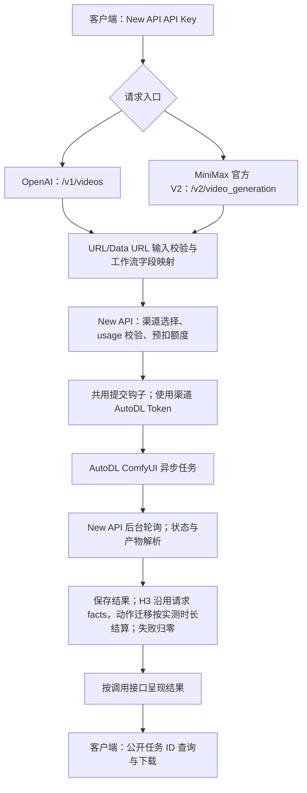

# AutoDL — New API Task Plugin

为 New API 提供 AutoDL.Art Task Plugin 适配，将 AutoDL ComfyUI 工作流接入 New API。

插件 key：`autodl`；显示名：**AutoDL**；当前版本：**v1.0.27**（插件元数据为 `1.0.27`）。

**调用方从这里开始：[5 分钟快速开始与完整 API 参考](API.md#5-分钟快速开始)。** 一份文档介绍 OpenAI Videos 与 MiniMax 官方 V2 两种接口；每种都有完整 curl、创建响应、任务查询和成功结果字段。覆盖文生视频、图片 URL/Data URL、图+音频、图+视频、语音合成，并提供常用模型与错误速查；后半部分保留完整字段类型、必填/默认值、工作流范围、计费及技术限制，无需跳到其他说明文档。

**AutoDL 官网工作流 ID 直接作为 MiniMax V2 的 `model`。** 在 `model` 填 `minimax_h3_z0901`、`minimax_h3_lightx2v` 等 workflow ID，继续使用 `content / resolution / duration / ratio`，统一调用 `POST /v2/video_generation`；完整说明和多图、音频、首尾帧示例见 [MiniMax 官方 V2 API](API.md#minimax-官方-v2-api)。

**推荐安装地址：** [https://raw.githubusercontent.com/yiyinfaith/new-api-plugin-autodl/main/plugin.js](https://raw.githubusercontent.com/yiyinfaith/new-api-plugin-autodl/main/plugin.js)

支持：

- OpenAI Video 接口（`POST /v1/videos`，16 个视频工作流，另含 `wan2.2-animate-move` 渠道别名）
- MiniMax 官方 V2 路径和请求格式（`POST /v2/video_generation`、`GET /v2/query/video_generation/{task_id}`，17 个工作流 ID 直接作为 `model`，动作迁移别名 `wan2.2-animate-move` 同样可用）
- 通过 New API 管理全部 17 个工作流的异步任务
- AutoDL ComfyUI 异步任务
- OpenAI、MiniMax V2 两种请求格式
- H3 视频工作流和动作迁移工作流
- indexTTS2 音频工作流
- 后续新增工作流扩展

通过官方 Task Plugin API v1 实现，调用方填写的 `model` 与官网工作流 ID 一致；两种格式都在解码层把各自的请求形状转换成该工作流实际参数。两种格式共用同一套工作流定义、提交、轮询、计费和结果处理。

## URL 安装
**宿主前提：**使用官方 New API **v1.0.0-rc.43**，无需源码补丁、自定义镜像或 FFmpeg。插件只注册 `/v2/video_generation` 与 `/v2/query/video_generation/{task_id}` 两条路由，这两个路径不与宿主保留的命名空间相交；`/v1/videos` 由宿主自身提供。**因此不需要任何转发配置、路径改写或额外配置文件，导入 `plugin.js` 这一个文件即可运行。**

1. 登录 New API 管理后台。已验证的 New API **v1.0.0-rc.43** 需要使用 **Root 账户**安装任务插件。
2. 打开「任务插件」，确认任务插件功能已启用。
3. 点击「上传插件」，在弹窗中选择「从 URL 导入」。
4. 粘贴下面的唯一推荐安装地址，并点击「读取 / Fetch」下载源码：

   ```text
   https://raw.githubusercontent.com/yiyinfaith/new-api-plugin-autodl/main/plugin.js
   ```

5. 读取插件信息后，确认插件 key 为 `autodl`、显示名为 **AutoDL**，安装并启用；安装完成后确认 AutoDL 为当前激活插件。
6. 新建渠道，类型选择 **Task Plugin（61）**。
7. 插件显示名选择 **AutoDL**（key：`autodl`）。
8. Base URL 填写 `https://autodl.art`，不要追加 `/api/v1`。
9. 密钥填写 AutoDL **ComfyUI 分组**的原始 Token，**不加 `Bearer `**。
10. 选择需要使用的官网工作流模型，配置模型价格，将渠道分组设为调用端 New API 密钥可访问的分组，再启用渠道。

**必须使用 Raw URL。** [GitHub 仓库首页](https://github.com/yiyinfaith/new-api-plugin-autodl) 是介绍页面，不能直接作为插件源码 URL 使用。上面的 `raw.githubusercontent.com/.../main/plugin.js` 才返回可导入的 JavaScript 源码。

URL 导入在浏览器中下载源码，因此使用管理后台的浏览器需要能访问 `raw.githubusercontent.com`。已验证的宿主版本支持 Plugin API v1、`usageProfiles`、`openai_video` 和 `credentialless` 产物下载；其他实例也需要具备这些能力。

**只需下载 `plugin.js` 即可安装并运行。** 工作流定义、参数映射、插件元信息和任务钩子均包含在这个文件中；不依赖本地 import、Node.js 文件系统或仓库其他文件。`export const meta` 就是官方插件元信息，无需额外 manifest 文件。

仓库只维护根目录的一个 `plugin.js` 和一个当前版本，更新后仍使用同一个 `main` Raw URL。`workflows.json`、`official-workflows.json`、`examples.json` 和 `prices.json` 用于查阅、示例及开发验证，插件运行时不会读取它们；测试脚本、校验文件、许可证和 `.github/` 也不是安装依赖。

从任何旧版更新：从上方唯一 Raw URL 导入并启用最新版 AutoDL（插件元数据里的版本号即当前版本）。保留任务记录、渠道、价格表达式和分组倍率；插件不需要任何路径转发配置。1.0.6 提升了官方格式容错，1.0.7 修复了动作迁移别名的按秒计费：`input_reference` 仍是推荐字段，旧 `images` 恢复为等价兼容别名（映射到同一批图片槽位，不会丢图），`duration` 成为全部工作流的 `seconds` 别名，官方非媒体字段接受并忽略，MiniMax 的 `callback_url` / `extra` 接受并忽略。只维护一个当前版本和安装地址。

**宿主升级：**继续使用官方 `calciumion/new-api:latest`，不维护源码修改。升级后检查插件 registered、模型价格 schema 及两种请求入口；未来若官方 Plugin API 发生不兼容变更，仍需正常回归验证。

**价格页只显示“特殊计费表达式”：**先在「任务插件」确认 AutoDL 运行状态为 registered。插件注册失败会使 `/api/pricing` 缺失 `billing_usage_schema`，每秒单价表退回显示原始表达式；这不等于保存的价格公式语法错误。恢复兼容宿主和插件注册后刷新价格页，保留原有公式、价格与分组倍率。

URL 安装不会自动配置渠道或导入模型价格。请完成上述渠道配置，并为要使用的模型设置价格；未配置价格时可能返回 `model_price_error`。7 个已核实模型的官方价格及表达式见下方价格章节和 [prices.json](prices.json)。

## 支持模型
下面的图片、音频、视频范围表示官网定义的最少数量和最多数量，**「文本 ✓/✗」表示该工作流是否接受文字提示词**（`prompt`；不接受的传了会报 `this workflow does not accept a text prompt`）。两种格式的转换层都会严格校验媒体数量。完整默认值、枚举、参数上下限和精确尺寸映射见 [workflows.json](workflows.json)。[examples.json](examples.json) 在根目录保留各工作流 ID 的统一参数示例，并在 `_formats.minimax` 中给出全部 17 个工作流的 MiniMax V2 请求体（音频工作流含 `emo_control_method` 扩展字段）；调用时只发送示例中的请求 body，音频工作流请以 `_formats.minimax` 的示例为准。

| 模型名 / 官网工作流 ID | 官网名称 | seconds 范围 | 输入媒体数量 | resolution |
|---|---|---|---|---|
| `minimax_h3_z0903` | H3六图三音频生视频（高质量音画融合） | 1–15 秒 | 图 1–6, 音频 1–3，文本 ✓ | 480p/768p/1088p/1440p |
| `minimax_h3_z0902` | H3六图生视频（多图一致性创作） | 1–15 秒 | 图 1–6，文本 ✓ | 480p/768p/1088p/1440p |
| `minimax_h3_z0901` | H3文生视频（高质量创意直出） | 1–15 秒 | 无需媒体，文本 ✓ | 480p/768p/1088p/1440p |
| `minimax_h3_zm_u24` | H3多图多音频生视频(升级画质) | 1–15 秒 | 图 1–9, 音频 0–3，文本 ✓ | 480p/768p |
| `minimax_h3_zm_u08` | H3多图多音频生视频(高速版) | 1–15 秒 | 图 1–9, 音频 0–3，文本 ✓ | 480p/768p |
| `minimax_h3_b99_002` | H3首尾帧生成视频 | 1–15 秒 | 图 2–2，文本 ✓ | 736p |
| `minimax_h3_b99_001` | H3文生视频 | 1–15 秒 | 无需媒体，文本 ✓ | 736p |
| `minimax_h3_b99_003_12s` | H3多图生视频12秒 | 1–12 秒 | 图 1–9，文本 ✓ | 736p |
| `wan2.2animate-v4-motion_retargeting` | 动作迁移 | 无时长控制 | 图 1–1, 视频 1–1，文本 ✗ | 832p/464p |
| `minimax_h3_image_audio_to_video_v2_15s` | H3多图多音频生视频15秒 | 1–15 秒 | 图 0–9, 音频 0–3，文本 ✓ | 480p/768p |
| `minimax_h3_lightx2v_v5_15s` | H3多图生视频15秒 | 1–15 秒 | 图 1–9，文本 ✓ | 480p/768p |
| `minimax_h3_image_audio_to_video_v2` | H3多图多音频生视频 | 1–10 秒 | 图 0–9, 音频 0–3，文本 ✓ | 480p/768p/1080p |
| `minimax_h3_image_audio_to_video` | H3图生视频-音频同步(自动对口型) | 1–15 秒 | 图 1–1, 音频 1–1，文本 ✗ | 480p/768p/1080p |
| `minimax_h3_lightx2v_v5` | H3多图参考生视频 | 1–10 秒 | 图 1–9，文本 ✓ | 480p/768p/1080p |
| `minimax_h3_lightx2v_no_pic` | H3文生视频 | 1–15 秒 | 无需媒体，文本 ✓ | 480p/768p |
| `minimax_h3_lightx2v` | H3首尾帧生成视频 | 1–15 秒 | 图 2–2，文本 ✓ | 480p/768p |
| `indextts2-v1` | indextts2 | 无时长参数（按成片实测计费） | 音频 1–2，文本 ✓ | 无 |

官网 API 定义快照保存在 [official-workflows.json](official-workflows.json)，获取日期为 2026-10-07。全部 17 个工作流定义与指定 7 个模型的价格在 2026-10-08 再次从官网读取核实。未来新增工作流时，添加 `WORKFLOWS` 条目、统一字段映射及测试，不需要修改 New API。

## 渠道与鉴权说明
官方绑定字段是 `setting.task_plugin_key: "autodl"`。插件不声明 `meta.channelTypes: [61]`，该字段用于旧渠道类型，官方禁止用它声明 Task Plugin 类型。

调用端的 `Authorization: Bearer <NEW_API_KEY>` 是 New API 密钥；插件访问 AutoDL 使用 `Authorization: <AUTODL_TOKEN>`，直接读取渠道 `ctx.apiKey`。访问媒体 CDN 时不发送 AutoDL 或 New API 密钥。不要将 Token 写入插件、仓库或示例文件。

两种格式的 `model` 都使用官网完整工作流 ID，例如 `minimax_h3_lightx2v_no_pic`。动作迁移另有公开别名 `wan2.2-animate-move`，**两种格式都能直接填**（插件自行解析到 `wan2.2animate-v4-motion_retargeting`，发往上游的 `model` 始终是实际 ID）。渠道也可以再加一条同名映射指向该工作流，那是等价路径、不是前提；请按**请求实际使用的 model 名**单独配置价格（例如 `billing_setting.plugin_billing_expr` 中的 `autodl::wan2.2-animate-move`），避免影响其他插件。**动作迁移按成片秒数计费**：1.0.7 起别名自带 `seconds` usage profile，价格页会出现「视频生成单价」输入；请确认别名与 workflow ID 的价格表达式都包含 `u("seconds")`。rc.41 允许多个插件共享模型名，选择 AutoDL 渠道时由 AutoDL 执行；如其他插件也声明同名模型，请用渠道分组等现有设置控制调用渠道。

## 两种请求格式与入口
OpenAI 格式用统一字段（`prompt` / `seconds` / `size` / `input_reference` / `audios` / `videos` / `seed`）；MiniMax V2 格式用 `content` 数组加 `role` 标注媒体用途。

两种格式的完整字段表、类型、取值范围与报错行为见 [API 文档](API.md) 的《参数总览》与《接口速查》，此处不再重复。

## 输入媒体：URL 与 Data URL
图片、音频、视频都接受公网 HTTP(S) URL 与标准 Base64 Data URL（Base64 会校验 MIME 类型、字符集与填充位）。

格式细则与拒绝规则见 [API 文档](API.md) 的《输入媒体：URL 与 Data URL》。

## MiniMax 官方兼容 API
提交 `POST /v2/video_generation`，查询 `GET /v2/query/video_generation/{task_id}`；请求体为 `model` + `content`（用 `role` 指定媒体用途）+ `resolution` / `ratio` / `duration` 等。

请求结构、提交与查询示例、`adaptive` 比例、TTS 音频扩展与完整 TTS 示例见 [API 文档](API.md) 的《MiniMax 官方 V2 API》一节。

## 同一首尾帧任务的两种等价请求
首尾帧在部分工作流中命名为 `first_frame` / `last_frame`，在另一些中为 `ref_image_0` / `ref_image_1`。插件按位置做等价映射，两种写法结果一致。

细节见 [API 文档](API.md) 的《参数总览》。

## OpenAI 统一参数
`POST /v1/videos` 提交、`GET /v1/videos/{id}` 查询，路由由宿主自身提供；插件负责把统一字段映射到具体工作流参数，并支持动作迁移别名 `wan2.2-animate-move`。

字段、示例与查询响应见 [API 文档](API.md) 的《OpenAI Videos API》一节。

## input_reference 与协议限制
`input_reference` 是推荐写法，`images` 是等价别名（二者只能选一个），既可传单个对象也可传多图数组。

单图/多图差异、未知字段的处理差异等见 [API 文档](API.md) 的《OpenAI Videos API》与《工作流目录与能力边界》。

## 调用示例
两种格式的完整 curl 示例、Base64 Data URL 示例与响应样例见 [API 文档](API.md) 的《请求示例》。

仓库内另提供可直接运行的 [test-task.py](test-task.py)（两种格式）与 [test-video.py](test-video.py)（OpenAI 格式），用法见下方《自动测试客户端》。

## 指定 7 个模型的官方价格
7 个 H3 工作流的官网单价（高峰/低谷 × 480p/768p/1080p）见 [API 文档](API.md) 的《价格与用量》一节，可直接粘贴的完整表达式见 [prices.json](prices.json)。其余 10 个工作流未提供默认价，需自行配置。**怎么配置见下一节。**

当前实例使用 CNY 展示、`USDExchangeRate=1`，表达式直接填官网数值，不做换汇加价；既有用户组倍率仍由 New API 叠加。价格快照取自 2026-10-08，官网后续调价不会自动同步。

### 动作迁移与别名

动作迁移官网价为期 08:00–24:00 ¥0.04/成片秒、00:00–08:00 ¥0.03/成片秒，与分辨率无关，表达式见下一节模板 B。它按**实测成片秒数**结算，调用方声明的秒数只决定预扣。

OpenAI 格式使用别名时，需要在渠道里配置模型映射：

```json
{"wan2.2-animate-move":"wan2.2animate-v4-motion_retargeting"}
```

别名是**独立的模型名**，必须按请求使用的名字单独配置价格；**两种格式都能用**（MiniMax V2 也接受该别名，无需先做渠道映射）。详见 [API 文档](API.md) 的《动作迁移与 wan2.2-animate-move 别名》。

## 在 New API 中配置按秒计费（表达式教程）
插件只负责**把真实的生成秒数报给 New API**（通过用量字段），**具体单价由你在 New API 里配置**。不配价格时调用会返回 `model_price_error`。这一节是完整操作步骤。

### 第 0 步：先知道有哪些用量字段可用

表达式中用 `u("字段名")` 读取插件上报的用量。可用的字段取决于模型：

| 字段 | 含义 | 哪些模型有 |
|---|---|---|
| `u("seconds")` | **计费秒数**（按秒计费的核心） | 全部 19 个模型/别名 |
| `u("resolution")` | 分辨率档位，如 `480p`/`768p`/`1080p` | H3 视频工作流、动作迁移 |
| `u("orientation")` | 朝向，如 `portrait`/`landscape`/`square` | H3 视频工作流、动作迁移 |
| `u("requests")` | 请求数：成功为 `1`，失败为 `0` | 全部 |

另外 New API 内置 `hour("时区")` 返回 0–23 的小时数，用于区分高峰/低谷。**失败任务会同时把 `requests` 和 `seconds` 归零**，所以按秒计费天然不会对失败扣费。

### 第 1 步：打开模型定价

管理后台 → **模型价格**（或「定价」/「模型倍率」页面）→ 找到要配置的模型名（例如 `minimax_h3_lightx2v_no_pic`）→ 计费方式选择 **表达式 / `tiered_expr`**。

> ⚠️ **每个模型名都要单独配价**，包括别名。用 `wan2.2-animate-move` 走渠道映射时，那是**另一个模型名**，必须单独给它配价格表达式，两者不会互相继承。

### 第 2 步：填表达式（三种模板，按需选一种）

**模板 A：单一单价（最简单）** —— 只要按秒收费，不分时段和分辨率：

```text
u("seconds") * 0.04
```

**模板 B：高峰/低谷两档** —— 北京时间 08:00–24:00 为高峰，00:00–08:00 为低谷：

```text
hour("Asia/Shanghai") < 8 ? tier("off_peak", u("seconds") * 0.03) : tier("peak", u("seconds") * 0.04)
```

**模板 C：高峰/低谷 × 分辨率分档** —— H3 这类按分辨率定价的工作流用这个（下面以 `minimax_h3_lightx2v_v5` 为例，就是 480p / 768p / 1080p）：

```text
hour("Asia/Shanghai") < 8 ? tier("off_peak", u("seconds") * (u("resolution") == "480p" ? 0.02 : (u("resolution") == "768p" ? 0.03 : 0.05))) : tier("peak", u("seconds") * (u("resolution") == "480p" ? 0.03 : (u("resolution") == "768p" ? 0.04 : 0.09)))
```

只有两档分辨率的模型（如 `minimax_h3_lightx2v_no_pic`）把第三个分支删掉，写成：

```text
hour("Asia/Shanghai") < 8 ? tier("off_peak", u("seconds") * (u("resolution") == "480p" ? 0.02 : 0.03)) : tier("peak", u("seconds") * (u("resolution") == "480p" ? 0.03 : 0.04))
```

模板里的数字要换成你站点的实际单价；本文档下表列出的是官网快照价（人民币元/生成秒）。

### 第 3 步（推荐）：直接复制现成表达式

[prices.json](prices.json) 里每个模型的 `expression` 字段都是**逐字核对过**的完整表达式，可以直接整段粘贴，不用自己拼：

```json
"minimax_h3_lightx2v_no_pic": {
  "prices": [{"resolution": "480p", "peak": 0.03, "off_peak": 0.02}, ...],
  "expression": "hour(\"Asia/Shanghai\") < 8 ? tier(\"off_peak_480p\", u(\"seconds\") * 0.02) : ..."
}
```

### 第 4 步：TTS 与动作迁移的特殊写法

**TTS（`indextts2-v1` / `IndexTTS-2`）** 单价 ¥0.001/秒，官方最低收费 ¥0.010。表达式**只需要**写单价：

```text
u("seconds") * 0.001
```

**不要**把最低价写进表达式（例如 `max(u("seconds") * 0.001, 0.01)`）。原因有两条：一是插件已经在轮询与结算两处把秒数下限抬到 10 秒（`10 × ¥0.001 = ¥0.010`），**实际扣费不会低于官方最低价**；二是经线上实测，把条件或 `max()` 嵌进单价的表达式在模型广场**渲染不出来**，价格显示不出来时模型看起来像免费，风险更大。所以：

```text
hour("Asia/Shanghai") < 8 ? tier("off_peak", u("seconds") * 0.03) : tier("peak", u("seconds") * 0.04)
```

**动作迁移** 的表达式就是上面的模板 B（¥0.04 高峰 / ¥0.03 低谷，与分辨率无关）。它的秒数取**成片实测**，不是调用方声明值。

### 第 5 步：验证

1. 配好后先在模型广场/定价页确认**价格能显示出来**（显示为空说明表达式渲染失败，需要退回模板 A 的最简形式排查）；
2. 用最小参数发一次真实请求（例如 5 秒 480p），确认预扣金额 = 单价 × 秒数；
3. 查询任务详情里的用量字段，确认 `seconds` 与成片时长一致；
4. 故意发一个参数错误的请求（必定失败），确认**没有实际扣费**（失败会把 `requests`/`seconds` 归零）。

### 常见坑

| 现象 | 原因 | 处理 |
|---|---|---|
| `model_price_error` | 该模型名没配价格，或只能用别名配了、实际模型名没配 | 给**实际请求的模型名**和**渠道映射后的别名**都配价 |
| 价格页显示为空 | 表达式渲染失败（嵌套 `max()`/多层条件） | 用上面的模板，把最低价交给插件处理 |
| 扣费为 0 | `seconds` 上报为 0 | 检查是否失败任务（正常）；成功任务为 0 属异常，请报 issue |
| 扣费多于预期 | 用了不同时段的单价，或站点分组倍率 | `hour()` 取的是**实际结算时刻**，跨 00:00/08:00 可能与时段的预扣不同；倍率由 New API 另行叠加 |
| 跨时段金额不一致 | 预扣和结算各取当时的 `hour()` | 属预期行为；AutoDL 未公开跨时段判定时点 |

## 自动测试客户端
Python 脚本只依赖标准库。真实调用会消耗 AutoDL 余额，先完成渠道和价格配置。

```powershell
$env:NEW_API_BASE_URL = 'https://your-new-api.example'
$env:NEW_API_KEY = '填写NewAPI密钥'
python .\test-video.py --prompt '一个红色小球' --seconds 1 --size 864x480 --out result.mp4
python .\test-video.py --model minimax_h3_lightx2v --prompt '镜头平稳推进' --seconds 1 --size 864x480 --input-reference 'https://your-public-file-host.example/first.png' --input-reference 'https://your-public-file-host.example/last.png' --out reference-result.mp4
python .\test-task.py --format minimax --request tts-body.json --out result.wav
```

`test-task.py` 使用两种模式各自的提交和查询路径：OpenAI 为 Videos API，MiniMax 为官方 V2。提交一次、有截止时间地轮询，再下载产物。OpenAI 模式支持 16 个视频工作流；音频工作流请选 MiniMax 模式。`--example <工作流ID>` 配合 `--format openai|minimax` 可选两种示例，但必需媒体占位 URL 要先换为真实地址。OpenAI 的 `--artifact` 只接受 `video`；MiniMax 接受 `video|audio` 并检查查询的 `modality`。无效类型在提交前拒绝，下载不覆盖已有文件。

```powershell
python .\test-task.py --format minimax --request minimax-request.json --out result.mp4
python .\test-task.py --format openai --example minimax_h3_lightx2v --out result.mp4
python .\test-task.py --format minimax --example indextts2-v1 --out result.wav
```

连续查询失败五次停止，不覆盖已有输出文件。两个脚本默认 Base URL 是本机 `http://127.0.0.1:3000`，调用远程实例时设置环境变量。

## 错误、轮询与产物
状态映射（`QUEUED`→`QUEUED`、`RUNNING`→`IN_PROGRESS`、`SUCCESS`/`completed`→`SUCCESS`、`FAILED`→`FAILURE`，其余为 `UNKNOWN`）、排队与运行的约 30 分钟截止、各类错误的表现，以及产物下载规则见 [API 文档](API.md) 的《错误、轮询和计费》。

下载链接为短期有效的签名地址，不附带 New API 与 AutoDL 密钥，请及时保存。

## 精确尺寸与需确认项目
各分辨率档位对应的精确 `宽x高`、可用方向、`size` 参数支持情况，以及秒数取值规则见 [API 文档](API.md) 的《分辨率、方向与精确 size》与《计费时长与结算》。

## 插件如何工作
插件运行在 New API 的任务插件沙箱中。New API 负责验证调用方密钥、选择渠道、预扣额度、保存公开任务 ID、后台轮询与任务归属检查；AutoDL 负责运行 ComfyUI 工作流。客户端只需要提交一次，再使用提交响应中的 New API 任务 ID 查询结果。



OpenAI 解码器将 `prompt / seconds / size / input_reference / audios / videos / seed` 等统一字段转换成该工作流实际参数；MiniMax 解码器解析 `content`，按 `model` 指定的工作流、媒体 role、时长和比例映射到同一份 `WORKFLOWS` 定义。两者都会校验业务字段、媒体数量并应用已定义的默认值，不支持的能力明确报错。

两种入口最终都生成同一份 AutoDL ComfyUI body（`ref_image_* / ref_audio_* / ref_video / duration / resolution` 等官网字段），工作流身份由 `model` 决定，请求体不参与路由。

两种入口最终共用 `buildSubmitRequest / parseSubmitResponse / buildQueryRequest / parseTaskResult` 及结算、artifact 逻辑。提交时保存 `facts / workflowId / type / submittedAt / timeoutSeconds`，H3 完成时沿用请求用量；动作迁移提交时按调用方声明秒数预扣（省略则默认 5 秒），任务创建成功后立即对参考视频做一次受限 Range 读取（公网 URL）或内联 Base64 解码（Data URL），把实测输入时长写入任务状态。结算顺序是「成片新探测 → 轮询记录的成片时长 → 上游 usage 块」，取到的值即为最终计费秒数，不再以声明秒数为上限（提交阶段测得的输入时长**不参与计费**，理由见下）。AutoDL 的 `data.duration` 是运行耗时，不作为生成秒数。视频工作流成功时选择视频产物，TTS 选择音频；下载产物时不向媒体站点发送渠道 Token。TTS 没有时长参数，但 AutoDL 按 `audio_sec_cost` 计费（¥0.001/秒，最低 ¥0.010），因此其计费秒数同样来自成片实测：轮询与结算各做一次受限 Range 读取，解析 WAV/MP3 的真实时长。官方最低计费不外写进广场表达式（渲染器不支持嵌套三元与 max()），而由插件把结算秒数下限抬到 10 秒（10 秒 × ¥0.001 = ¥0.010，与官方最低计费一致），解析失败时也至少按 10 秒结算。

插件不会替用户上传本地媒体，也不会自动导入价格。动作迁移的输入测量最多读取首个 1 MiB，按 URL 缓存结果，并受 rc.43 的 4 次 fetch、单次 15 秒、单 hook 30 秒限制；无法读取或无法解析时不测量，回退到声明秒数，不阻塞任务。MiniMax `adaptive` 使用已确认的工作流默认方向降级，具体限制见 [API 文档](API.md#比例与-adaptive)。上线前请为全部要调用的工作流（含 OpenAI 动作迁移别名）配置价格；仅安装插件不足以完成渠道和计费配置。

**动作迁移结算的实测顺序：**测量在提交阶段与渲染并行完成，结算钩子会再次尝试读取成片，取值顺序是「成片新探测 → 轮询记录的成片时长 → 上游 usage 块」，取到的值即为最终计费秒数；声明值只决定提交时的预扣，不封顶结算。**提交阶段测得的输入（参考）视频时长不参与计费**（它只用于展示提交了什么；动作迁移只渲染检测到的人物轨迹，参考片通常长于成片，按它计费会多收——该缺陷已在 1.0.26 修复）。实测过程与证据见 [输入媒体真实测试记录](MEDIA_TEST_RESULTS.md#104-提交阶段测量输入视频2026-10-11)。

## 相关官方资料
- [New API Task Plugin API v1](https://docs.newapi.pro/zh/docs/plugins/api-reference)
- [New API 插件开发指南](https://docs.newapi.pro/zh/docs/plugins/development)
- [New API 官方插件示例](https://github.com/QuantumNous/new-api-plugins)
- [AutoDL ComfyUI API 文档](https://autodl.art/docs/comfyui_api/)
- [AutoDL 官网工作流列表](https://www.autodl.art/large-model/comfyui)

许可证沿用此仓库的 [AGPL-3.0 LICENSE](LICENSE)。
