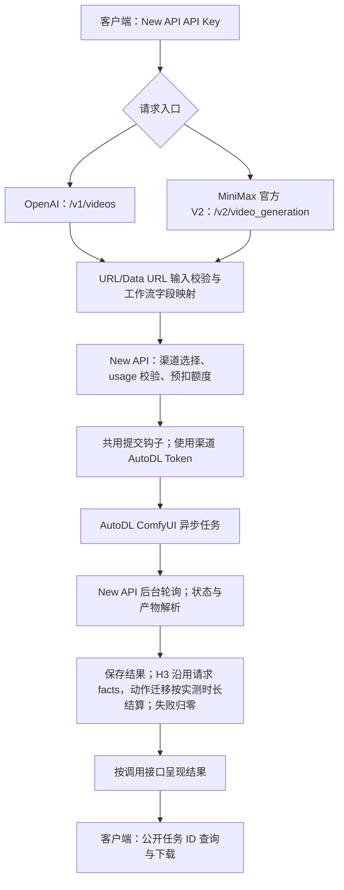

# AutoDL — New API Task Plugin

为 New API 提供 AutoDL.Art Task Plugin 适配，将 AutoDL ComfyUI 工作流接入 New API。

插件 key：`autodl`；显示名：**AutoDL**；当前版本：**v1.0.8**（插件元数据为 `1.0.8`）。

**调用方从这里开始：[5 分钟快速开始与完整 API 参考](API.md#5-分钟快速开始)。** 一份文档介绍 OpenAI 与 MiniMax 官方 V2 两种接口；每种都有完整 curl、创建响应、任务查询和成功结果字段。覆盖文生视频、图片 URL/Data URL、图+音频、图+视频，并提供常用模型与错误速查；后半部分保留完整字段类型、必填/默认值、工作流范围、计费及技术限制，无需跳到其他说明文档。

**AutoDL 官网工作流 ID 直接作为 MiniMax V2 的 `model`。** 在 `model` 填 `minimax_h3_z0901`、`minimax_h3_lightx2v` 等 workflow ID，继续使用 `content / resolution / duration / ratio`，统一调用 `POST /v2/video_generation`；完整说明和多图、音频、首尾帧示例见 [MiniMax 官方 V2 API](API.md#minimax-官方-v2-api)。

**推荐安装地址：** [https://raw.githubusercontent.com/yiyinfaith/new-api-plugin-autodl/main/plugin.js](https://raw.githubusercontent.com/yiyinfaith/new-api-plugin-autodl/main/plugin.js)

支持：

- OpenAI Video 接口（`POST /v1/videos`，16 个视频工作流，另含 `wan2.2-animate-move` 渠道别名）
- MiniMax 官方 V2 路径和请求格式（`POST /v2/video_generation`、`GET /v2/query/video_generation/{task_id}`，17 个工作流 ID 直接作为 `model`）
- 通过 New API 管理全部 17 个工作流的异步任务
- AutoDL ComfyUI 异步任务
- OpenAI、MiniMax V2 两种请求格式
- H3 视频工作流和动作迁移工作流
- indexTTS2 音频工作流
- 后续新增工作流扩展

通过官方 Task Plugin API v1 实现，调用方填写的 `model` 与官网工作流 ID 一致；两种格式都在解码层把各自的请求形状转换成该工作流实际参数。两种格式共用同一套工作流定义、提交、轮询、计费和结果处理。

## 插件如何工作

插件运行在 New API 的任务插件沙箱中。New API 负责验证调用方密钥、选择渠道、预扣额度、保存公开任务 ID、后台轮询与任务归属检查；AutoDL 负责运行 ComfyUI 工作流。客户端只需要提交一次，再使用提交响应中的 New API 任务 ID 查询结果。



OpenAI 解码器将 `prompt / seconds / size / input_reference / audios / videos / seed` 等统一字段转换成该工作流实际参数；MiniMax 解码器解析 `content`，按 `model` 指定的工作流、媒体 role、时长和比例映射到同一份 `WORKFLOWS` 定义。两者都会校验业务字段、媒体数量并应用已定义的默认值，不支持的能力明确报错。

两种入口最终都生成同一份 AutoDL ComfyUI body（`ref_image_* / ref_audio_* / ref_video / duration / resolution` 等官网字段），工作流身份由 `model` 决定，请求体不参与路由。

两种入口最终共用 `buildSubmitRequest / parseSubmitResponse / buildQueryRequest / parseTaskResult` 及结算、artifact 逻辑。提交时保存 `facts / workflowId / type / submittedAt / timeoutSeconds`，H3 完成时沿用请求用量；动作迁移提交时按调用方声明秒数预扣，任务创建成功后立即对参考视频做一次受限 Range 读取（公网 URL）或内联 Base64 解码（Data URL），把实测输入时长写入任务状态。结算顺序是「成片新探测 → 轮询记录的成片时长 → 提交阶段测得的输入时长 → 声明秒数」；声明值决定预扣上限。AutoDL 的 `data.duration` 是运行耗时，不作为生成秒数。视频工作流成功时选择视频产物，TTS 选择音频；下载产物时不向媒体站点发送渠道 Token。

插件不会替用户上传本地媒体，也不会自动导入价格。动作迁移的输入测量最多读取首个 1 MiB，按 URL 缓存结果，并受 rc.43 的 4 次 fetch、单次 15 秒、单 hook 30 秒限制；无法读取或无法解析时不测量，回退到声明秒数，不阻塞任务。MiniMax `adaptive` 使用已确认的工作流默认方向降级，具体限制见 [API 文档](API.md#比例与-adaptive)。上线前请为全部要调用的工作流（含 OpenAI 动作迁移别名）配置价格；仅安装插件不足以完成渠道和计费配置。

**动作迁移结算的实测顺序：**测量在提交阶段与渲染并行完成，结算钩子会再次尝试读取成片，取值顺序是「成片新探测 → 轮询记录的成片时长 → 提交阶段测得的输入时长 → 声明秒数」；声明值仍决定提交时的预扣上限。实测过程与证据见 [输入媒体真实测试记录](MEDIA_TEST_RESULTS.md#104-提交阶段测量输入视频2026-10-11)。

## URL 安装

**宿主前提：**使用官方 New API **v1.0.0-rc.43**，无需源码补丁、自定义镜像或 FFmpeg。插件只注册 `/v2/video_generation` 与 `/v2/query/video_generation/{task_id}` 两条路由，这两个路径不与宿主保留的命名空间相交；`/v1/videos` 由宿主自身提供。**因此不需要任何转发配置、路径改写或额外配置文件，导入 `plugin.js` 这一个文件即可运行。**

1. 登录 New API 管理后台。已验证的 New API **v1.0.0-rc.43** 需要使用 **Root 账户**安装任务插件。
2. 打开「任务插件」，确认任务插件功能已启用。
3. 点击「上传插件」，在弹窗中选择「从 URL 导入」。
4. 粘贴下面的唯一推荐安装地址，并点击「读取 / Fetch」下载源码：

   ```text
   https://raw.githubusercontent.com/yiyinfaith/new-api-plugin-autodl/main/plugin.js
   ```

5. 读取插件信息后，确认插件 key 为 `autodl`、显示名为 **AutoDL**，安装并启用；安装完成后确认 AutoDL 为当前激活插件。
6. 新建渠道，类型选择 **Task Plugin（61）**。
7. 插件显示名选择 **AutoDL**（key：`autodl`）。
8. Base URL 填写 `https://autodl.art`，不要追加 `/api/v1`。
9. 密钥填写 AutoDL **ComfyUI 分组**的原始 Token，**不加 `Bearer `**。
10. 选择需要使用的官网工作流模型，配置模型价格，将渠道分组设为调用端 New API 密钥可访问的分组，再启用渠道。

**必须使用 Raw URL。** [GitHub 仓库首页](https://github.com/yiyinfaith/new-api-plugin-autodl) 是介绍页面，不能直接作为插件源码 URL 使用。上面的 `raw.githubusercontent.com/.../main/plugin.js` 才返回可导入的 JavaScript 源码。

URL 导入在浏览器中下载源码，因此使用管理后台的浏览器需要能访问 `raw.githubusercontent.com`。已验证的宿主版本支持 Plugin API v1、`usageProfiles`、`openai_video` 和 `credentialless` 产物下载；其他实例也需要具备这些能力。

**只需下载 `plugin.js` 即可安装并运行。** 工作流定义、参数映射、插件元信息和任务钩子均包含在这个文件中；不依赖本地 import、Node.js 文件系统或仓库其他文件。`export const meta` 就是官方插件元信息，无需额外 manifest 文件。

仓库只维护根目录的一个 `plugin.js` 和一个当前版本，更新后仍使用同一个 `main` Raw URL。`workflows.json`、`official-workflows.json`、`examples.json` 和 `prices.json` 用于查阅、示例及开发验证，插件运行时不会读取它们；测试脚本、校验文件、许可证和 `.github/` 也不是安装依赖。

从 1.0.7 更新：从上方唯一 Raw URL 导入并启用 AutoDL 1.0.8。保留任务记录、渠道、价格表达式和分组倍率；插件不需要任何路径转发配置。1.0.6 提升了官方格式容错，1.0.7 修复了动作迁移别名的按秒计费：`input_reference` 仍是推荐字段，旧 `images` 恢复为等价兼容别名（映射到同一批图片槽位，不会丢图），`duration` 成为全部工作流的 `seconds` 别名，官方非媒体字段接受并忽略，MiniMax 的 `callback_url` / `extra` 接受并忽略。只维护一个当前版本和安装地址。

**宿主升级：**继续使用官方 `calciumion/new-api:latest`，不维护源码修改。升级后检查插件 registered、模型价格 schema 及两种请求入口；未来若官方 Plugin API 发生不兼容变更，仍需正常回归验证。

**价格页只显示“特殊计费表达式”：**先在「任务插件」确认 AutoDL 运行状态为 registered。插件注册失败会使 `/api/pricing` 缺失 `billing_usage_schema`，每秒单价表退回显示原始表达式；这不等于保存的价格公式语法错误。恢复兼容宿主和插件注册后刷新价格页，保留原有公式、价格与分组倍率。

URL 安装不会自动配置渠道或导入模型价格。请完成上述渠道配置，并为要使用的模型设置价格；未配置价格时可能返回 `model_price_error`。7 个已核实模型的官方价格及表达式见下方价格章节和 [prices.json](prices.json)。

## 支持模型

下面的图片、音频、视频范围表示官网定义的最少数量和最多数量。两种格式的转换层都会严格校验媒体数量。完整默认值、枚举、参数上下限和精确尺寸映射见 [workflows.json](workflows.json)。[examples.json](examples.json) 在根目录保留各工作流 ID 的统一参数示例，并在 `_formats.minimax` 中给出全部 17 个工作流的 MiniMax V2 请求体（音频工作流含 `emo_control_method` 扩展字段）；调用时只发送示例中的请求 body，音频工作流请以 `_formats.minimax` 的示例为准。

| 模型名 / 官网工作流 ID | 官网名称 | seconds 范围 | 输入媒体数量 | resolution |
|---|---|---|---|---|
| `minimax_h3_z0903` | H3六图三音频生视频（高质量音画融合） | 1–15 秒 | 图 1–6, 音频 1–3 | 480p/768p/1088p/1440p |
| `minimax_h3_z0902` | H3六图生视频（多图一致性创作） | 1–15 秒 | 图 1–6 | 480p/768p/1088p/1440p |
| `minimax_h3_z0901` | H3文生视频（高质量创意直出） | 1–15 秒 | 无需媒体 | 480p/768p/1088p/1440p |
| `minimax_h3_zm_u24` | H3多图多音频生视频(升级画质) | 1–15 秒 | 图 1–9, 音频 0–3 | 480p/768p |
| `minimax_h3_zm_u08` | H3多图多音频生视频(高速版) | 1–15 秒 | 图 1–9, 音频 0–3 | 480p/768p |
| `minimax_h3_b99_002` | H3首尾帧生成视频 | 1–15 秒 | 图 2–2 | 736p |
| `minimax_h3_b99_001` | H3文生视频 | 1–15 秒 | 无需媒体 | 736p |
| `minimax_h3_b99_003_12s` | H3多图生视频12秒 | 1–12 秒 | 图 1–9 | 736p |
| `wan2.2animate-v4-motion_retargeting` | 动作迁移 | 无时长控制 | 图 1–1, 视频 1–1 | 832p/464p |
| `minimax_h3_image_audio_to_video_v2_15s` | H3多图多音频生视频15秒 | 1–15 秒 | 图 0–9, 音频 0–3 | 480p/768p |
| `minimax_h3_lightx2v_v5_15s` | H3多图生视频15秒 | 1–15 秒 | 图 1–9 | 480p/768p |
| `minimax_h3_image_audio_to_video_v2` | H3多图多音频生视频 | 1–10 秒 | 图 0–9, 音频 0–3 | 480p/768p/1080p |
| `minimax_h3_image_audio_to_video` | H3图生视频-音频同步(自动对口型) | 1–15 秒 | 图 1–1, 音频 1–1 | 480p/768p/1080p |
| `minimax_h3_lightx2v_v5` | H3多图参考生视频 | 1–10 秒 | 图 1–9 | 480p/768p/1080p |
| `minimax_h3_lightx2v_no_pic` | H3文生视频 | 1–15 秒 | 无需媒体 | 480p/768p |
| `minimax_h3_lightx2v` | H3首尾帧生成视频 | 1–15 秒 | 图 2–2 | 480p/768p |
| `indextts2-v1` | indextts2 | 无时长控制 | 音频 1–2 | 无 |

官网 API 定义快照保存在 [official-workflows.json](official-workflows.json)，获取日期为 2026-10-07。全部 17 个工作流定义与指定 7 个模型的价格在 2026-10-08 再次从官网读取核实。未来新增工作流时，添加 `WORKFLOWS` 条目、统一字段映射及测试，不需要修改 New API。

## 渠道与鉴权说明

官方绑定字段是 `setting.task_plugin_key: "autodl"`。插件不声明 `meta.channelTypes: [61]`，该字段用于旧渠道类型，官方禁止用它声明 Task Plugin 类型。

调用端的 `Authorization: Bearer <NEW_API_KEY>` 是 New API 密钥；插件访问 AutoDL 使用 `Authorization: <AUTODL_TOKEN>`，直接读取渠道 `ctx.apiKey`。访问媒体 CDN 时不发送 AutoDL 或 New API 密钥。不要将 Token 写入插件、仓库或示例文件。

两种格式的 `model` 都使用官网完整工作流 ID，例如 `minimax_h3_lightx2v_no_pic`。OpenAI 格式另外保留 `wan2.2-animate-move` 渠道别名：渠道需加入该模型名，并用模型映射指向 `wan2.2animate-v4-motion_retargeting`，再按动作迁移的计费表达式单独配置价格（例如 `billing_setting.plugin_billing_expr` 中的 `autodl::wan2.2-animate-move`），避免影响其他插件。**动作迁移按成片秒数计费**：1.0.7 起别名自带 `seconds` usage profile，价格页会出现「视频生成单价」输入；请确认别名与 workflow ID 的价格表达式都包含 `u("seconds")`。MiniMax V2 不接受该别名，请直接填工作流 ID。rc.41 允许多个插件共享模型名，选择 AutoDL 渠道时由 AutoDL 执行；如其他插件也声明同名模型，请用渠道分组等现有设置控制调用渠道。

## 两种请求格式与入口

| 格式 | 提交入口 | 识别规则 | 返回与查询 |
|---|---|---|---|
| OpenAI | `POST /v1/videos` | 保留现有 `prompt / seconds / size / input_reference / audios / videos / seed` | 原有 OpenAI Video 响应；查询 `GET /v1/videos/{task_id}` |
| MiniMax 官方 V2 | `POST /v2/video_generation` | JSON `model + content + resolution + duration + ratio`；不与 OpenAI 字段混用 | 提交返回 `task_id`；查询 `GET /v2/query/video_generation/{task_id}`，返回官方 `task` 包装 |

**H3 的 OpenAI 参数格式和校验保持不变；动作迁移在两种格式下都新增必需的秒数声明。** 不通过 `duration`、`resolution` 或 `ref_image_*` 等容易冲突的字段猜测格式。两种格式均使用 New API 密钥鉴权、AutoDL 渠道和同一套价格配置。`/v1/videos` 由宿主提供，插件只注册 MiniMax V2 的两条 `/v2/...` 路由。

OpenAI 入口服务 16 个视频工作流（外加 `wan2.2-animate-move` 别名）；MiniMax V2 入口可用全部 17 个工作流，包括 indexTTS2 音频工作流。

## 输入媒体：URL 与 Data URL

1.0.0 起完成付费生成验证；后续版本另以官方 rc.43 隔离测试验证计费规则和提交阶段的输入视频测量，任务 ID、视频结果和测试边界见 [输入媒体真实测试记录](MEDIA_TEST_RESULTS.md)。

| 请求格式 | 图片 | 音频 | 视频 |
|---|---|---|---|
| OpenAI Video | `input_reference.image_url` 或对象数组 | `audios[]` | `videos[]` |
| MiniMax V2 | `content[].image_url.url` | `content[].audio_url.url` | `content[].video_url.url` |

以上已有媒体字段同时接受公网 HTTP(S) URL 和标准 `data:image/...;base64,...`、`data:audio/...;base64,...`、`data:video/...;base64,...`。MIME 前缀必须匹配字段类型；Base64 必须使用标准字母表和正确补位，不能传裸 Base64、百分号编码、换行、额外 charset 参数或 `file_id`。仍按 workflow 校验媒体数量，不增加官方协议字段。Data URL 是适配器的输入扩展，实际媒体格式、尺寸与内容仍受上游限制。

**输出继续返回公网 URL，不返回 Base64。** 输入 Data URL 原样传给 AutoDL；动作迁移的输入测量对 `data:video/...;base64` 做内联解码，不下载远端媒体，仍受 New API 请求体/JS 资源及上游媒体限制。完整编码示例见 [API 输入媒体说明](API.md#输入媒体url-与-data-url)。

## MiniMax 官方兼容 API

实现前核对了 [MiniMax H3 V2 官方创建接口](https://platform.minimax.io/docs/api-reference/video-generation-v2-create) 与官方多模态请求示例。`content` 的媒体 `type` 是 `image_url / audio_url / video_url`，`first_frame` 等是 **role**，不是 type：

| content 项 | 结构 | AutoDL 映射 |
|---|---|---|
| 文本 | `{"type":"text","text":"描述"}` | 该工作流的 `prompt` 或 `prompt_text`；最多一项 |
| 首帧 | `{"type":"image_url","image_url":{"url":"https://…"},"role":"first_frame"}` | `first_frame`，或支持单图的工作流的唯一图片字段 |
| 尾帧 | 同上，`role: "last_frame"` | `last_frame`；仅支持该能力的工作流接受 |
| 参考图 | 同上，`role: "reference_image"` | 按出现顺序映射 `ref_image_*` 或唯一图片字段 |
| 参考音频 | `{"type":"audio_url","audio_url":{"url":"https://…"},"role":"reference_audio"}` | 按出现顺序映射工作流音频槽位 |
| 参考视频 | `{"type":"video_url","video_url":{"url":"https://…"},"role":"reference_video"}` | 按出现顺序映射工作流视频槽位，如 `ref_video` |

省略图片 role 时遵循官方的 `first_frame` 含义；多图参考工作流应明确写 `reference_image`。首尾帧按 role 定位，重复 role、缺少必需帧、超出媒体数量或混合首尾帧与参考媒体都报错。图片、音频、视频输入均接受公开 HTTP(S) URL 或标准 Base64 Data URL；不支持裸 Base64、文件 ID 或二进制上传。

带分辨率控制的工作流必须提供 `resolution`；`ratio` 按下方官方场景规则处理。`model` 填 AutoDL 工作流 ID 时，分辨率映射如下：

| MiniMax 风格 resolution | 插件对应 AutoDL 档位 |
|---|---|
| `480P` | `480p` |
| `768P` | `768p` |
| `2K` | `1440p`；仅支持该档位的工作流可用 |
| `1080p`、`1088p`、`736p`、`464p`、`832p` | 保留 AutoDL 特有档位作为扩展值，按具体工作流校验 |

`model` 填 AutoDL 工作流 ID 时，特有档位也接受完整原始 resolution 枚举标签，例如 `736p横`。参考模式显式指定具体 `ratio` 时，原标签方向必须一致；首尾帧模式或 `adaptive` 则按下方自动方向规则处理。已有 MiniMax 官方名称的档位使用 `480P / 768P / 2K`，不使用小写别名。

支持官方全部 ratio 枚举：`adaptive / 21:9 / 16:9 / 4:3 / 1:1 / 3:4 / 9:16`。场景规则来自 MiniMax 官方 V2 文档：

| 场景 | ratio 规则 |
|---|---|
| 纯文生：content 只有 text | 必须显式指定具体比例；省略或传 `adaptive` 按官方规则报错 |
| 首帧 / 尾帧 / 首尾帧 | 始终按 `adaptive`；其他合法比例接受后也按 adaptive 处理，遵循官方 i2va 语义 |
| 参考图 / 视频 / 音频 | ratio 可省略，默认 `adaptive`；也可显式指定任一具体比例 |

**单文件插件的 adaptive 降级限制：**当前单文件插件未实现远程图片/视频尺寸探测。仅下载 `plugin.js` 无法测量参考媒体的真实宽高，也不会根据文件名、URL 参数或客户端具体 ratio 假装推断尺寸。因此本适配器接受 adaptive，并按已确认的方案使用所选工作流官网默认分辨率的方向，再在请求档位中选择同方向选项。当前工作流默认方向为竖屏；默认 resolution 档位不会覆盖请求的 resolution。此方案不保证输出与参考媒体真实比例一致，也不是 MiniMax 服务端的尺寸自适应实现。

具体比例映射：`21:9 / 16:9 / 4:3` 选择横屏，`3:4 / 9:16` 选择竖屏，`1:1` 优先选择方形。该分辨率没有方形选项时，降级到官网默认方向。AutoDL 只提供固定横/竖/方档位，插件不额外缩放或裁切，因此 21:9、4:3、3:4 以及缺少方形选项时的 1:1 不保证精确比例；实际像素仍以工作流官方档位为准。分辨率和时长不做降级。

`model` 填 AutoDL 工作流 ID 时，`duration`、`audio_duration` 和 `seed` 继续按该工作流原字段与范围校验，保留 1 秒生成及 AutoDL 特有分辨率等能力；不支持的控制明确拒绝，两个时长字段不互相替换。

### AutoDL 扩展字段与任务身份

MiniMax V2 请求的 `model` 就是 AutoDL 工作流 ID，插件按该工作流的规则校验 `content`、`resolution`、`duration` 与 `ratio`；不存在根据模型名自动选择工作流的行为，可用能力与上文 [支持模型](#支持模型) 表一致。TTS 音频工作流同样使用这两条 V2 路径，成功时 `task.modality` 为 `audio`。

为保留 AutoDL 能力，官网额外的非媒体控制可直接作为顶层扩展字段，例如 indexTTS2 的 `emo_control_method / emo_random / emo_calm ...`。不接受文本的图音频同步和动作迁移工作流不应加入 text 项；音频工作流也可用相同 content 结构，这是本插件的 AutoDL 扩展。`prompt / seconds / size / input_reference / audios / videos / orientation` 不与 content 混用；MiniMax 官方 `callback_url`、`extra` 等非媒体控制字段接受并忽略（上游没有对应能力），未知的媒体型字段仍报错。

indexTTS2 的情感控制就用这些顶层扩展字段：`emo_control_method` 取 `与音色参考音频相同`（默认）、`使用情感参考音频`（此时需要第二段参考音频 `emo_ref_audio`）、`使用情感向量控制`；向量字段为 `emo_afraid`、`emo_angry`、`emo_calm`、`emo_disgusted`、`emo_happy`、`emo_melancholic`、`emo_sad`、`emo_surprised`，范围见 catalog；`emo_random` 是 boolean。官网当前 `emo_surprised` 枚举只有字符串 `"0"`，本插件也接受数值 `0` 并原样交给上游。

New API 的任务记录保留调用方传入的 `model`（AutoDL 工作流 ID）作为外部模型身份，宿主用 `rewriteModel` 固定渠道映射后的实际工作流，用于轮询和用量校验；提交、计费和结果处理仍共用同一套钩子，不复制任务逻辑。

### V2 提交和查询

Base URL 填写 New API 站点根地址，密钥使用 New API API Key。`model` 填 AutoDL 工作流 ID，统一使用同一组 V2 路径：

```bash
curl -sS "$NEW_API_BASE_URL/v2/video_generation" \
  -H "Authorization: Bearer $NEW_API_KEY" \
  -H 'Content-Type: application/json' \
  -d '{"model":"minimax_h3_z0901","content":[{"type":"text","text":"一只猫在雪地中奔跑"}],"resolution":"768P","duration":5,"ratio":"16:9"}'

TASK_ID='提交响应中的task_id'
curl -sS "$NEW_API_BASE_URL/v2/query/video_generation/$TASK_ID" \
  -H "Authorization: Bearer $NEW_API_KEY"
```

音频工作流（`indextts2-v1`）走同样的两条路径，只是 `content` 只放 text 和 `reference_audio`，不传 `resolution / ratio / duration`。

提交成功响应仅为 `{"task_id":"task_..."}`。查询使用官方包装和状态，例如：

```json
{"task":{"id":"task_...","status":"succeeded","created_at":1785125529,"updated_at":1785125946,"content":{"url":"https://your-public-file-host.example/result.mp4"},"task_type":"generation","modality":"video"}}
```

状态转换仅发生在 V2 响应层：等待中为 `queued`，处理中和未识别的非终态为 `running`，成功为 `succeeded`，失败为 `failed`。失败任务包含 `task.error.code` 和 `task.error.message`；成功时 `task.content.url` 是公开产物 URL，可直接下载，无需向产物站点发送 New API 密钥。任务 ID 始终使用 New API 的公开 ID；宿主继续执行鉴权和任务归属检查。

**V2 兼容范围：**路径、请求解码、创建响应、查询包装、状态和视频产物 URL 对齐官方。V2 查询优先选择视频，音频工作流则选择音频，不将辅助预览图作为生成结果。rc.41 的公开 `TaskView` 不包含原请求、模型身份、计费事实或私有插件状态，AutoDL 查询的 `duration` 又是处理耗时，因此查询省略无法确认的 `model / resolution / duration / ratio / usage`，不伪造实际视频时长、比例或 token 用量。需要这些元数据的客户端尚不能做到完全替代官方服务。普通的创建—轮询—下载客户端只需替换 Base URL 和 API Key；`callback_url / extra` 接受并忽略，`file_id` 等确实无法实现的能力仍明确拒绝。HTTP 参数错误沿用宿主错误结构，不保证与 MiniMax 的错误包装完全相同。音频工作流是 AutoDL 扩展，成功时 `modality` 为 `audio`。

## 同一首尾帧任务的两种等价请求

OpenAI，提交到 `/v1/videos`：

```json
{"model":"minimax_h3_lightx2v","prompt":"镜头平稳推进","seconds":5,"size":"480x864","input_reference":[{"image_url":"https://your-public-file-host.example/first.png"},{"image_url":"https://your-public-file-host.example/last.png"}]}
```

MiniMax 官方 V2，提交到 `/v2/video_generation`：

```json
{"model":"minimax_h3_lightx2v","content":[{"type":"text","text":"镜头平稳推进"},{"type":"image_url","image_url":{"url":"https://your-public-file-host.example/first.png"},"role":"first_frame"},{"type":"image_url","image_url":{"url":"https://your-public-file-host.example/last.png"},"role":"last_frame"}],"resolution":"480P","duration":5,"ratio":"adaptive"}
```

两边的 `model` 是同一个官网工作流 ID，差别只在参数形状：`size: "480x864"` 与 `resolution: "480P"` 加 `ratio: "adaptive"` 指向同一档竖屏分辨率，`seconds` 与 `duration` 是同一份计费与生成秒数。

官网 `input_example` 与 [examples.json](examples.json) 里的说明文字都是占位说明，需要换成实际参数或 URL。

## OpenAI 统一参数

| 参数 | 类型 | 说明 |
|---|---|---|
| `model` | string | 官网工作流 ID，必填 |
| `prompt` | string | 文本；自动映射该工作流的 `prompt` 字段；不接受文本的工作流不应传 |
| `seconds` | integer / numeric string | 秒数；自动映射 `duration` 或 `audio_duration`；按模型校验范围 |
| `resolution` | string | `480p`、`768p` 等统一档位；支持值以模型表为准 |
| `orientation` | string | `portrait` 竖屏、`landscape` 横屏、`square` 方形；按工作流枚举校验 |
| `size` | string | 可选精确尺寸，如 `864x480`；只对已确认尺寸的工作流支持；与上述参数冲突时报错 |
| `input_reference` | object / object[] | 单张参考图用 `{ "image_url": "https://…" }`，多张用同结构对象数组；按顺序映射首尾帧或 `ref_image_*`，严格校验工作流允许的数量 |
| `audios` | string[] | 公开 HTTP(S) 音频 URL 或 `data:audio/...;base64,...`；按顺序映射参考音频 |
| `videos` | string[] | 公开 HTTP(S) 视频 URL 或 `data:video/...;base64,...`；动作迁移 `videos[0]` 映射 `ref_video` |
| `seed` | integer | 按官网该工作流的种子范围校验；没种子控制的工作流拒绝 |

省略可选参数时采用该工作流官网默认值。工作流能力不同，统一的是**参数名字**，不代表全部工作流具有相同的分辨率和时长控制。

OpenAI 入口只服务 16 个视频工作流。动作迁移没有 prompt 或可控生成时长，`seconds` 只声明计费秒数；indexTTS2 音频工作流不在这个入口，它的情感控制与音频参数见 [MiniMax 官方兼容 API](#minimax-官方兼容-api)。

JSON 和文本表单均可使用统一参数。表单里的 `input_reference` 单图填写 JSON 引用对象，多图填写 JSON 对象数组；也可重复同名文本字段，每项填写一个 JSON 引用对象，顺序保持不变。`audios` 和 `videos` 仍须 JSON 编码。参考媒体 URL 的过期时间要覆盖任务排队和处理。

## input_reference 与协议限制

已核对当前部署的 New API v1.0.0-rc.43：[Plugin API v1 文档的 Request body / Host protocols](https://github.com/QuantumNous/new-api/blob/c6741c36a9a1a729554ad94ee99f21602a214a23/docs/plugin-api/v1.md) 明确支持 `POST /v1/videos` 的 JSON 和 multipart 请求。JSON 对象和数组可原样传给插件；multipart 同名文本字段保留多个值和顺序，同名文件则各自具有独立 `FileReference`。本插件从引用对象的 `image_url` 提取公开 URL，文本表单使用 JSON 编码的引用对象。

[OpenAI 保留的 Videos Create 文档](https://developers.openai.com/api/reference/resources/videos/methods/create) 将 JSON `input_reference` 定义为一个引用对象，包含 `image_url` 或 `file_id`。本插件的**单图输入采用其中的 `image_url` 对象形式**；多图只在此结构基础上扩展为对象数组，经 New API 原样传给插件。多图对象数组是 **AutoDL 插件扩展**，不声称 OpenAI 自身的 Videos API 接受多图数组。

- **单图：** `"input_reference": {"image_url": "https://your-public-file-host.example/reference.png"}`；一个元素的引用对象数组也可以。
- **多图：** `"input_reference": [{"image_url": "https://your-public-file-host.example/first.png"}, {"image_url": "https://your-public-file-host.example/last.png"}]`。
- **文生视频和其他无图工作流：** 不传 `input_reference`；即使传空数组也报错。
- **单图工作流：** 必须恰好 1 张。
- **首尾帧工作流：** 必须恰好 2 张，第 1 张映射 `first_frame`，第 2 张映射 `last_frame`。
- **多图参考工作流：** 按数组顺序映射对应的 `ref_image_*`，数量以模型表为准（1–6、1–9，或官网允许图片全部可选的 0–9）。支持 0 张的工作流可省略字段或传 `[]`。
- **数量或类型不合法直接报错：** 不自动补齐、截断或跳过，不接受 `null` 占位、嵌套数组或混合类型数组。每个引用对象只能包含 `image_url`，其值必须为公开 HTTP(S) URL 或标准图片 Data URL 字符串；额外字段也会报错。裸 URL 字符串与字符串数组作为便捷写法被接受。
- `input_reference` 是**推荐**字段。旧 `images`（New API Sora 风格的 URL 数组）作为**兼容别名**保留，与 `input_reference` 等价并映射到同一批图片槽位；两者同时出现会报错。
- 官方非媒体字段（`metadata`、`mode`、`user`、`n`、`response_format`）接受并忽略。未知的媒体型字段名（如 `ref_image_0`、`file`）或未知对象字段仍明确报错——不会静默丢图，避免用户以为传了图却发出纯文生视频请求。

参考图接受公开 HTTP(S) URL 或标准图片 Data URL；不支持二进制文件上传和 `file_id`。包含 `file_id` 的引用对象会明确报错，即使同时提供 `image_url` 也不接受。本地文件可先编码成标准 Data URL，或上传到公开存储后填 URL；对象结构与数量规则不变。

推荐客户端使用 `model`、`prompt`、`seconds`、`size` 和 `input_reference`。`seconds` 接受整数或数字字符串；秒数及精确尺寸仍以 AutoDL 工作流枚举为准，不能直接套用 Sora 的枚举。`resolution`、`orientation`、音频/视频输入和种子等工作流扩展仍保留。

多图也可以使用 multipart 的重复文本字段，每项填写一个 JSON 引用对象；不使用 `@文件`：

```bash
export NEW_API_BASE_URL='https://your-new-api.example'
export NEW_API_KEY='填写NewAPI密钥'
curl -sS "$NEW_API_BASE_URL/v1/videos" \
  -H "Authorization: Bearer $NEW_API_KEY" \
  -F 'model=minimax_h3_lightx2v' \
  -F 'prompt=镜头平稳推进' \
  -F 'seconds=5' \
  -F 'size=864x480' \
  -F 'input_reference={"image_url":"https://your-public-file-host.example/first.png"}' \
  -F 'input_reference={"image_url":"https://your-public-file-host.example/last.png"}'
```

## 调用示例

16 个视频工作流支持标准 `POST /v1/videos`；全部 17 个工作流都能通过 MiniMax V2 的 `content` 结构提交，音频工作流只走该入口。

```bash
export NEW_API_BASE_URL='https://your-new-api.example'
export NEW_API_KEY='填写NewAPI密钥'
curl -sS "$NEW_API_BASE_URL/v1/videos" \
  -H "Authorization: Bearer $NEW_API_KEY" \
  -H 'Content-Type: application/json' \
  -d '{"model":"minimax_h3_lightx2v_no_pic","prompt":"一只猫在雪地中奔跑","seconds":"5","size":"864x480"}'
```

响应 `id` 是 New API 的公开任务 ID，后续不用 AutoDL 私有 ID。每隔 5–10 秒查询一次，到 `completed` / `failed` 停止，最长 30 分钟：

```bash
TASK_ID='提交返回的id'
curl -sS "$NEW_API_BASE_URL/v1/videos/$TASK_ID" -H "Authorization: Bearer $NEW_API_KEY"
curl -f "$NEW_API_BASE_URL/v1/videos/$TASK_ID/content" -H "Authorization: Bearer $NEW_API_KEY" --output result.mp4
```

成功标准视频响应包含 `url` 和 `results`；公共 ID、状态及时间字段由宿主生成。插件不会编造中间进度，只在成功时报告 100%。

首尾帧（两张图片，顺序为首帧和尾帧）：

```json
{"model":"minimax_h3_lightx2v","prompt":"镜头平稳推进","seconds":"5","size":"864x480","input_reference":[{"image_url":"https://your-public-file-host.example/first.png"},{"image_url":"https://your-public-file-host.example/last.png"}]}
```

图生视频、音频同步（没有文本输入，`seconds` 转为 `audio_duration`）：

```json
{"model":"minimax_h3_image_audio_to_video","seconds":"5","size":"480x864","input_reference":{"image_url":"https://your-public-file-host.example/person.png"},"audios":["https://your-public-file-host.example/voice.wav"]}
```

动作迁移（无可控生成时长或文本，seconds 仅声明计费秒数）：

```json
{"model":"wan2.2animate-v4-motion_retargeting","seconds":5,"resolution":"832p","orientation":"portrait","input_reference":{"image_url":"https://your-public-file-host.example/person.png"},"videos":["https://your-public-file-host.example/motion.mp4"]}
```

TTS 语音合成，通过 MiniMax V2 提交（`content` 只含 text 和 `reference_audio`，不传 `resolution / ratio / duration`；情感控制是顶层扩展字段）：

```bash
curl -sS "$NEW_API_BASE_URL/v2/video_generation" \
  -H "Authorization: Bearer $NEW_API_KEY" \
  -H 'Content-Type: application/json' \
  -d '{"model":"indextts2-v1","content":[{"type":"text","text":"你好，这是语音合成测试"},{"type":"audio_url","audio_url":{"url":"https://your-public-file-host.example/voice.wav"},"role":"reference_audio"}],"emo_control_method":"使用情感向量控制","emo_calm":0.3,"emo_random":false}'

TASK_ID='提交响应中的task_id'
curl -sS "$NEW_API_BASE_URL/v2/query/video_generation/$TASK_ID" -H "Authorization: Bearer $NEW_API_KEY"
```

音频工作流成功时查询响应的 `task.modality` 为 `audio`，`task.content.url` 指向音频产物；视频工作流则为 `video`。用该 URL 下载，不向产物站点发送 New API 密钥。

## 指定 7 个模型的官方价格

下面每格是 **高峰 / 空闲，人民币元/生成秒**。官网高峰为北京时间 08:00–24:00，空闲为 00:00–08:00。官网内部整数价除以 1000 后得到此金额；[prices.json](prices.json) 包含官方来源与完整 New API 表达式。

| 模型 | 480p | 768p | 1080p |
|---|---|---|---|
| `minimax_h3_lightx2v_no_pic` | 0.03 / 0.02 | 0.04 / 0.03 | — |
| `minimax_h3_lightx2v_v5` | 0.03 / 0.02 | 0.04 / 0.03 | 0.09 / 0.05 |
| `minimax_h3_lightx2v` | 0.03 / 0.02 | 0.04 / 0.03 | — |
| `minimax_h3_image_audio_to_video_v2` | 0.03 / 0.02 | 0.04 / 0.03 | 0.10 / 0.06 |
| `minimax_h3_image_audio_to_video` | 0.03 / 0.02 | 0.04 / 0.03 | 0.09 / 0.05 |
| `minimax_h3_image_audio_to_video_v2_15s` | 0.03 / 0.02 | 0.04 / 0.03 | — |
| `minimax_h3_lightx2v_v5_15s` | 0.03 / 0.02 | 0.04 / 0.03 | — |

这 7 个模型使用 `tiered_expr` 按 `u("seconds")`、`u("resolution")` 和 `hour("Asia/Shanghai")` 计费。例如一个 5 秒 480p 视频，高峰基础价为 ¥0.15，空闲为 ¥0.10。其余 10 个模型未提供本次默认价格，可在 New API 中自行配置。

当前指定实例使用 CNY 展示、`USDExchangeRate=1`，表达式直接填写上述数值，未做外汇换算或加价。其他实例如使用不同展示汇率，应由管理员按站点币种设置换算，不能盲目复制；既有分组倍率仍由 New API 应用。官网价格后续变化不会自动同步，本文件是已核实日期的快照。

**计费秒数（v1.0.7，无需修改宿主）：**15 个 H3 工作流有官方 `duration` 或 `audio_duration`，显式传值时按该值计费；省略时均按官网默认 **5 秒**。OpenAI 使用 `seconds`，MiniMax 使用 `duration`（音频同步工作流使用 `audio_duration`）。TTS 仍按请求次数计费。

动作迁移没有官方固定时长或默认秒数，时长跟随参考视频。因此必须声明参考视频秒数：OpenAI body 用 `seconds`，MiniMax body 用 `duration`。声明支持数值/普通十进制字符串，`0 < 秒数 <= 3600`，允许小数；该值决定提交时的预扣上限，不裁剪视频、不写入 AutoDL body。提交成功后插件立即对参考视频做一次测量：公网 MP4/WebM 用 `bytes=0-1048575` 受限 Range 读取，`data:video/...;base64` 内联解码。结算按「成片新探测 → 轮询记录的成片时长 → 提交阶段测得的输入时长 → 声明秒数」取值；远程服务器不支持 Range、URL 不在管理员允许主机或媒体格式无法解析时沿用声明值。请由可信客户端如实提供参考视频时长。

提交时 New API 预扣；成功按保存的请求用量结算，最终失败按 0 次/0 秒结算并退回预扣。上游 `data.duration` 是处理耗时，绝不作为生成秒数。New API 退款不代表 AutoDL 同时退款。

### 动作迁移按秒计费与渠道别名

官网工作流名为 **动作迁移**。截至 2026-10-08，官网价格为北京时间 **08:00–24:00 ¥0.04/成片秒，00:00–08:00 ¥0.03/成片秒**，分辨率不改变这两个单价。配置表达式为：

```text
hour("Asia/Shanghai") < 8 ? tier("off_peak", u("seconds") * 0.03) : tier("peak", u("seconds") * 0.04)
```

该工作流使用上述请求声明秒数，不依赖宿主扩展。高峰声明 5 秒时预扣 ¥0.20，成功结算按上面的实测顺序取值（通常与声明一致，实测成片更短则退回差额），最终失败退回预扣；受站点分组倍率影响。

OpenAI 的 `seconds` 和 MiniMax 的 `duration` 在动作迁移中仅是计费声明；与 H3 的可控生成时长不同。

OpenAI 格式若使用 `wan2.2-animate-move`，在渠道配置模型映射：

```json
{"wan2.2-animate-move":"wan2.2animate-v4-motion_retargeting"}
```

该别名的模型简介只填写 `动作迁移`，价格选择上述表达式；它只在 OpenAI 格式下有效，MiniMax V2 请直接使用实际 workflow ID。完整请求和计费说明见 [API 文档中的动作迁移章节](API.md#动作迁移与-wan22-animate-move-渠道别名)。站点按 CNY 展示且 `USDExchangeRate=1` 时直接填写这些数值；既有用户组倍率仍会影响最终收费。

## 自动测试客户端

Python 脚本只依赖标准库。真实调用会消耗 AutoDL 余额，先完成渠道和价格配置。

```powershell
$env:NEW_API_BASE_URL = 'https://your-new-api.example'
$env:NEW_API_KEY = '填写NewAPI密钥'
python .\test-video.py --prompt '一个红色小球' --seconds 1 --size 864x480 --out result.mp4
python .\test-video.py --model minimax_h3_lightx2v --prompt '镜头平稳推进' --seconds 1 --size 864x480 --input-reference 'https://your-public-file-host.example/first.png' --input-reference 'https://your-public-file-host.example/last.png' --out reference-result.mp4
python .\test-task.py --format minimax --request tts-body.json --out result.wav
```

`test-task.py` 使用两种模式各自的提交和查询路径：OpenAI 为 Videos API，MiniMax 为官方 V2。提交一次、有截止时间地轮询，再下载产物。OpenAI 模式支持 16 个视频工作流；音频工作流请选 MiniMax 模式。`--example <工作流ID>` 配合 `--format openai|minimax` 可选两种示例，但必需媒体占位 URL 要先换为真实地址。OpenAI 的 `--artifact` 只接受 `video`；MiniMax 接受 `video|audio` 并检查查询的 `modality`。无效类型在提交前拒绝，下载不覆盖已有文件。

```powershell
python .\test-task.py --format minimax --request minimax-request.json --out result.mp4
python .\test-task.py --format openai --example minimax_h3_lightx2v --out result.mp4
python .\test-task.py --format minimax --example indextts2-v1 --out result.wav
```

连续查询失败五次停止，不覆盖已有输出文件。两个脚本默认 Base URL 是本机 `http://127.0.0.1:3000`，调用远程实例时设置环境变量。

## 错误、轮询与产物

- `QUEUED` → `QUEUED`，`RUNNING` → `IN_PROGRESS`，`SUCCESS` / `completed` → `SUCCESS`，`FAILED` → `FAILURE`。其他状态为 `UNKNOWN`。
- 401/403 检查 ComfyUI 分组和原始 Token；400/422 是参数错误；404/410 是任务或工作流不存在；429 是限流；5xx 是上游服务异常。
- 无效 JSON、成功响应缺少 `task_id`、空/异常 `results`、非法媒体 URL 都会报错或进入失败终态。错误文本中的渠道 Token 会脱敏。
- 重试/后台轮询由 New API 负责。正常排队、运行和未知状态有 30 分钟插件截止时间；不会取消上游任务，也不保证 AutoDL 退款。宿主默认连续轮询错误上限为 20，最终遵循实例配置。
- 单次 HTTP 超时由宿主 `RELAY_TIMEOUT`、`RELAY_RESPONSE_HEADER_TIMEOUT` 控制；插件 API v1 无请求级 `timeout` 字段。插件沿用宿主超时配置。
- 产物支持 video/audio/image/file，稳定 key 如 `video`、`audio`、`video-2`。音频识别 WAV、MP3、FLAC，视频识别 MP4、WebM。
- `/content` 支持 GET、HEAD 和宿主安全转发的 Range。AutoDL 的 TOS 结果 URL 按 GET 签名，因此插件统一用 GET 请求 CDN；客户端请求 HEAD 时，rc.41 宿主复制响应头后关闭上游正文，只返回响应头。使用 `credentialless: true`，不把渠道密钥发给 CDN；宿主校验目标和重定向。
- AutoDL 结果 URL 有效期较短，代理下载不会延长 URL 有效期。本插件没有自动转存，需要长期保存时及时下载到自己的存储。

## 精确尺寸与需确认项目

`resolution` 档位相同不等于所有工作流的实际宽高相同。例如 z0902/z0903 的 768p 竖屏是 768×1376，z0901 和原文生视频的对应尺寸是 768×1344。尺寸按工作流独立映射，未知尺寸不猜测。

原文生视频支持六个精确 `size`：`480x864`、`864x480`、`480x480`、`768x1344`、`1344x768`、`768x768`。`1280x720` 不在其枚举内，明确拒绝。

**此项需要确认：**动作迁移官网枚举标签为 464×832 / 832×464，内部节点值却为 468/832。插件保留官方选项，通过 `resolution: "464p"` 和方向选择，不承诺精确 `size`。如果必须保证最终像素，需要工作流维护者确认实际输出尺寸或提供真实生成文件信息。

## 相关官方资料

- [New API Task Plugin API v1](https://docs.newapi.pro/zh/docs/plugins/api-reference)
- [New API 插件开发指南](https://docs.newapi.pro/zh/docs/plugins/development)
- [New API 官方插件示例](https://github.com/QuantumNous/new-api-plugins)
- [AutoDL ComfyUI API 文档](https://autodl.art/docs/comfyui_api/)
- [AutoDL 官网工作流列表](https://www.autodl.art/large-model/comfyui)

许可证沿用此仓库的 [AGPL-3.0 LICENSE](LICENSE)。
